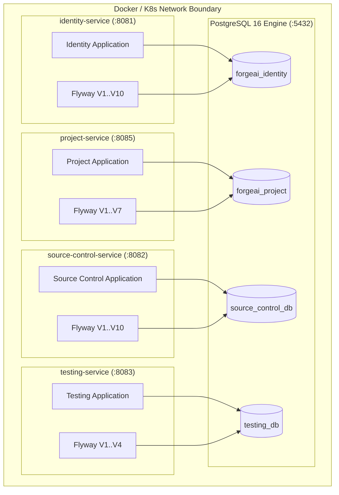
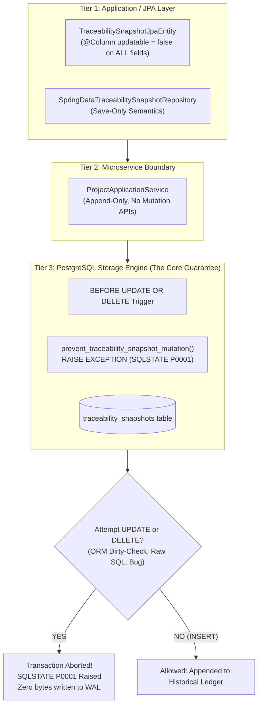

# Database Schema Evolution & Tamper-Proof Audit Immutability in ForgeAI

## 1. Executive Summary & Core Challenge

In an enterprise engineering governance platform like ForgeAI—which records regulatory compliance snapshots, git commit lineages, security vulnerability assessments, and sprint task lifecycles—data integrity is subject to strict compliance regimes (e.g., SOC 2 Type II, ISO 27001, and HIPAA). 

Two foundational distributed systems challenges emerge:
1. **Zero-Downtime Multi-Service Schema Evolution:** How do you evolve PostgreSQL database schemas across four decoupled Java microservices (`identity-service`, `project-service`, `source-control-service`, and `testing-service`) without breaking running instances, causing downtime, or allowing Hibernate to auto-mutate production tables?
2. **Absolute Immutability for Audit Records & Snapshots:** How do you guarantee that once an audit log or historical traceability snapshot is created, **nobody—not even an application developer, an accidental ORM dirty-check flush, a compromised API endpoint, or an internal administrator script—can modify or delete it?**

ForgeAI resolves these challenges through a **Database-Per-Service Architecture, Strict Flyway Automated Migrations with Checksum Validation (`ddl-auto: validate`), and PostgreSQL Storage Engine-Level `BEFORE UPDATE OR DELETE` Trigger Guards (SQLSTATE `P0001`)**.

---

## 2. Multi-Service Database Topology (Database-per-Service)

ForgeAI enforces complete physical database isolation. No two microservices share a database or connection pool:



### Architectural Safeguards:
- **Zero Cross-Database Joins:** Microservices cannot perform SQL joins across service boundaries. Cross-service data correlation (e.g., Project Task $\leftrightarrow$ GitHub Commit $\leftrightarrow$ CI Test Run) is aggregated asynchronously via REST APIs or the RabbitMQ Event Mesh.
- **Independent Schema Lifecycles:** Each service team can deploy, migrate, and roll back their database independently without synchronizing downtime windows with other microservices.
- **Credential Isolation:** The connection string and credentials used by `source-control-service` have zero access to `forgeai_project` or `forgeai_identity`.

---

## 3. Safe Schema Evolution Strategy (Flyway + Hibernate Validate)

### 3.1 Strict Configuration Contract
In all four microservices (`application.yml`), Hibernate is explicitly stripped of DDL generation privileges:

```yaml
spring:
  jpa:
    hibernate:
      ddl-auto: validate   # Flyway manages schema; Hibernate only verifies mappings
    show-sql: false
  flyway:
    enabled: true
    locations: classpath:db/migration
    validate-on-migrate: true   # Fails fast if migration checksums drift
    baseline-on-migrate: false  # Rejects unversioned legacy databases
```

| Configuration | Setting | Purpose |
| :--- | :--- | :--- |
| `hibernate.ddl-auto` | `validate` | **Strict read-only safety:** Prohibits `update`, `create`, or `create-drop` at runtime. If a Java entity attribute does not match the PostgreSQL column type, the Spring context aborts during startup. |
| `flyway.validate-on-migrate` | `true` | Calculates the SHA-256 checksum of every `.sql` script and verifies it against the `flyway_schema_history` table. Any retroactive edit of an applied migration halts deployment immediately. |
| `flyway.baseline-on-migrate` | `false` | Prevents blind baseline assumptions; all environments (local Docker, CI testcontainers, staging, production) must follow an identical versioned lineage. |

---

### 3.2 The Expand-Contract (Parallel Run) Migration Pattern

To ensure zero-downtime continuous deployment where old (`v1`) and new (`v2`) container replicas run concurrently during a rolling update, migrations adhere to **Additive-Only Evolution**:

```
PHASE 1: EXPAND (Additive Migration)
   - Add new nullable columns or columns with DEFAULT values (e.g. ADD COLUMN IF NOT EXISTS status VARCHAR(32) DEFAULT 'PENDING')
   - Deploy v1 and v2 simultaneously; both versions function normally without query breakage.

PHASE 2: BACKFILL & TRANSITION
   - Background job or trigger populates data for new columns.
   - Code writes to both old and new representations or reads with fallbacks.

PHASE 3: CONTRACT (Deprecation Cleanup)
   - Once 100% of traffic is on v2, release an additive migration in a later sprint to add NOT NULL constraints or drop deprecated columns.
```

**Real Codebase Precedent:**
In [`services/project-service/src/main/resources/db/migration/V4__outbox_dead_letter_snapshot_meta_and_audit.sql`](file:///c:/Users/asus/OneDrive/Desktop/Desktop%201/7th%20sem/major/ForgeAI/services/project-service/src/main/resources/db/migration/V4__outbox_dead_letter_snapshot_meta_and_audit.sql#L4-L20):
```sql
ALTER TABLE outbox_events ADD COLUMN IF NOT EXISTS status VARCHAR(32) NOT NULL DEFAULT 'PENDING';
ALTER TABLE outbox_events ADD COLUMN IF NOT EXISTS max_attempts INT NOT NULL DEFAULT 5;
ALTER TABLE outbox_events ADD COLUMN IF NOT EXISTS next_retry_at TIMESTAMPTZ;
ALTER TABLE outbox_events ADD COLUMN IF NOT EXISTS dead_letter_at TIMESTAMPTZ;

-- Non-blocking partial indices for active polling workers
CREATE INDEX IF NOT EXISTS idx_proj_outbox_poll ON outbox_events (created_at ASC)
    WHERE published_at IS NULL AND (status IS NULL OR status IN ('PENDING', 'RETRYING'));
```
Notice:
- `ADD COLUMN IF NOT EXISTS` prevents collision on restarts.
- `DEFAULT` values ensure existing rows satisfy constraints immediately without table-locking rewrites.
- Partial indices (`WHERE published_at IS NULL`) minimize index maintenance overhead on high-throughput tables.

---

## 4. The 3-Tier Defense-in-Depth Immutability Architecture

When recording **Traceability Snapshots** and **Audit Events**, soft conventions or application-level flags are insufficient. ForgeAI implements a 3-tier defense-in-depth model where immutability is guaranteed by the PostgreSQL database engine itself:



---

### Tier 1: JPA / Hibernate Entity Layer (`updatable = false`)
In [`TraceabilitySnapshotJpaEntity.java`](file:///c:/Users/asus/OneDrive/Desktop/Desktop%201/7th%20sem/major/ForgeAI/services/project-service/src/main/java/com/forgeai/project/infrastructure/persistence/entity/TraceabilitySnapshotJpaEntity.java#L16-L52), every single attribute is explicitly locked:

```java
@Id
@GeneratedValue(strategy = GenerationType.UUID)
@Column(name = "id", nullable = false, updatable = false)
private UUID id;

@Column(name = "workspace_id", nullable = false, updatable = false)
private UUID workspaceId;

@Column(name = "snapshot_name", nullable = false, length = 255, updatable = false)
private String snapshotName;

@Column(name = "schema_version", nullable = false, length = 32, updatable = false)
private String schemaVersion = "1.0";

@JdbcTypeCode(SqlTypes.JSON)
@Column(name = "snapshot_data", nullable = false, columnDefinition = "jsonb", updatable = false)
private String snapshotData;

@Column(name = "created_at", nullable = false, updatable = false)
private Instant createdAt = Instant.now();
```
**Mechanism:** Even if a buggy service method mutates an attribute in memory and calls `save()`, Hibernate’s dirty-checking engine completely excludes `updatable = false` columns from the generated SQL `UPDATE` statement.

---

### Tier 2: Repository & Domain Service Layer (Append-Only Semantics)
- Repositories only declare query accessors (`findById`, `findByProjectId`) and insertion operations (`save`).
- There are no service-layer endpoints or command handlers that accept an `UpdateSnapshotCommand` or `DeleteSnapshotCommand`.
- The API layer exposes only `POST /api/v1/projects/{projectId}/traceability/snapshots` and `GET /api/v1/projects/{projectId}/traceability/snapshots`.

---

### Tier 3: PostgreSQL Engine-Level Triggers (The Bulletproof Guarantee)

Application-level checks can be bypassed by raw SQL queries, DBA errors, or rogue maintenance scripts. To make tampering impossible, ForgeAI enforces immutability inside the database engine itself.

#### 1. Traceability Snapshot Trigger:
From [`services/project-service/src/main/resources/db/migration/V3__snapshot_immutability.sql`](file:///c:/Users/asus/OneDrive/Desktop/Desktop%201/7th%20sem/major/ForgeAI/services/project-service/src/main/resources/db/migration/V3__snapshot_immutability.sql#L5-L22):

```sql
CREATE OR REPLACE FUNCTION prevent_traceability_snapshot_mutation()
RETURNS TRIGGER AS $$
BEGIN
    IF TG_OP = 'DELETE' THEN
        RAISE EXCEPTION 'Traceability snapshots are immutable historical governance records and cannot be deleted. (id: %)', OLD.id
            USING ERRCODE = 'P0001';
    ELSE
        RAISE EXCEPTION 'Traceability snapshots are immutable historical governance records and cannot be updated. (id: %)', NEW.id
            USING ERRCODE = 'P0001';
    END IF;
END;
$$ LANGUAGE plpgsql;

DROP TRIGGER IF EXISTS trg_prevent_traceability_snapshot_mutation ON traceability_snapshots;
CREATE TRIGGER trg_prevent_traceability_snapshot_mutation
BEFORE UPDATE OR DELETE ON traceability_snapshots
FOR EACH ROW
EXECUTE FUNCTION prevent_traceability_snapshot_mutation();
```

#### 2. Universal Audit Event Trigger across All Microservices:
Present across `identity-service`, `project-service`, `source-control-service`, and `testing-service` in their respective `outbox_dead_letter_and_audit.sql` migrations:

```sql
CREATE TABLE IF NOT EXISTS audit_events (
    id UUID PRIMARY KEY DEFAULT gen_random_uuid(),
    organization_id UUID NOT NULL,
    actor_user_id VARCHAR(64),
    event_type VARCHAR(64) NOT NULL,
    entity_type VARCHAR(64) NOT NULL,
    entity_id VARCHAR(255) NOT NULL,
    action VARCHAR(64) NOT NULL,
    outcome VARCHAR(32) NOT NULL,
    correlation_id VARCHAR(64),
    trace_id VARCHAR(64),
    metadata JSONB,
    created_at TIMESTAMPTZ NOT NULL DEFAULT NOW()
);

CREATE OR REPLACE FUNCTION prevent_audit_event_mutation()
RETURNS TRIGGER AS $$
BEGIN
    IF TG_OP = 'DELETE' THEN
        RAISE EXCEPTION 'Audit events are immutable records and cannot be deleted. (id: %)', OLD.id
            USING ERRCODE = 'P0001';
    ELSE
        RAISE EXCEPTION 'Audit events are immutable records and cannot be updated. (id: %)', NEW.id
            USING ERRCODE = 'P0001';
    END IF;
END;
$$ LANGUAGE plpgsql;

DROP TRIGGER IF EXISTS trg_prevent_audit_event_mutation ON audit_events;
CREATE TRIGGER trg_prevent_audit_event_mutation
BEFORE UPDATE OR DELETE ON audit_events
FOR EACH ROW
EXECUTE FUNCTION prevent_audit_event_mutation();
```

### Why SQLSTATE `P0001` Matters:
- `P0001` is the PostgreSQL standard SQLSTATE code for `raise_exception`.
- When PostgreSQL executes a `BEFORE UPDATE OR DELETE` trigger that raises `P0001`, the query fails immediately.
- The entire PostgreSQL transaction is aborted (`ABORT TRANSACTION`).
- No data is modified on disk or written to the Write-Ahead Log (WAL).
- The calling Java service receives a `org.postgresql.util.PSQLException: ERROR: ... is an immutable historical governance record`, rolling back any surrounding Spring `@Transactional` context.

---

## 5. Defense-in-Depth Comparison Matrix

| Attack / Failure Vector | Prevented By | Layer | Result |
| :--- | :--- | :--- | :--- |
| **Developer forgets and writes `entity.setName("new")`** | Hibernate `@Column(updatable = false)` | ORM / JPA | Hibernate omits column from generated SQL `UPDATE` statement. |
| **Buggy service method calls `snapshotRepo.deleteById(id)`** | PostgreSQL `BEFORE DELETE` Trigger | Database Engine | PostgreSQL aborts statement with `P0001`; Spring rolls back transaction. |
| **Rogue DBA or compromised SQL connection executes `UPDATE audit_events SET ...`** | PostgreSQL `BEFORE UPDATE` Trigger | Database Engine | PostgreSQL aborts statement with `P0001`; zero rows updated. |
| **Developer alters an applied migration script in Git** | Flyway Checksum Validation (`validate-on-migrate: true`) | Migration Engine | Service startup aborts with `FlywayValidateException: Migration checksum mismatch`. |
| **Cross-service data corruption (e.g. Identity Service modifying Project records)** | Database-Per-Service Architecture | PostgreSQL Network Layer | Impossible: `identity-service` has zero database credentials or network access to `forgeai_project`. |

---

## 6. 🎤 Interview Playbook: How to Answer in System Design & Architecture Interviews

When an interviewer asks:
> *"In a platform that tracks engineering compliance, pull requests, and security audits, how do you manage database schema changes safely across your four Java microservices as features evolve, and how do you guarantee that once an audit log or traceability snapshot is written, nobody—not even a buggy service method—can overwrite or delete it?"*

Use the structured responses below to demonstrate Staff-level architectural maturity.

---

### ⏱️ The 30-Second Elevator Pitch Answer
> *"We manage schema evolution across our four Java microservices using a **Database-Per-Service pattern with Flyway versioned migrations** and strict `hibernate.ddl-auto: validate`. Hibernate is strictly forbidden from altering tables at runtime, and migrations use an **additive Expand-Contract pattern** so running instances never suffer downtime during rolling deployments.
> 
> To guarantee that audit logs and traceability snapshots cannot be overwritten or deleted, we enforce immutability at the **PostgreSQL storage engine level**. We configure **`BEFORE UPDATE OR DELETE` database triggers** in PL/pgSQL that raise exceptions with SQLSTATE `P0001`. Even if a developer accidentally invokes `repository.delete()`, a background worker encounters an ORM bug, or someone runs a rogue raw SQL query, the database engine aborts the transaction immediately. Combined with Hibernate `@Column(updatable = false)`, this provides bulletproof, tamper-proof audit trails for SOC 2 compliance."*

---

### ⏱️ The 2-Minute STAR Framework Answer

#### **Situation (The Challenge)**
*"In ForgeAI, we provide enterprise engineering governance, linking requirements, PRs, and CI test results into an immutable Traceability Spine. In compliance environments (SOC 2, ISO 27001), audit logs and compliance snapshots must be legally tamper-proof. Furthermore, across our four Java microservices (`identity`, `project`, `source-control`, `testing`), feature updates are deployed continuously without coordinated maintenance windows."*

#### **Task (The Goal)**
*"We had two strict technical requirements:
1. Guarantee zero-downtime database schema evolution without cross-service locking or runtime Hibernate mutations.
2. Ensure that once an audit event or traceability snapshot is written, it is mathematically and operationally impossible to mutate or delete, even by an application bug or an internal SQL query."*

#### **Action (What We Engineered)**
*"We implemented a defense-in-depth architecture across the data and application tiers:
1. **Database-Per-Service & Flyway Validation:** Each microservice has its own isolated PostgreSQL database. We use Flyway for version-controlled migration scripts with `validate-on-migrate: true` (which checks SHA-256 script checksums) and set `hibernate.ddl-auto: validate`. We practice the **Expand-Contract pattern**: all schema changes are purely additive (using `ADD COLUMN IF NOT EXISTS` with defaults) so older and newer microservice replicas operate simultaneously during zero-downtime rolling updates.
2. **Entity-Level Protection:** On `TraceabilitySnapshotJpaEntity`, every field is explicitly annotated with `@Column(updatable = false)`, preventing Hibernate from including them in SQL update statements.
3. **Database Engine Immutability Triggers:** Most importantly, we implemented PostgreSQL `BEFORE UPDATE OR DELETE` triggers in PL/pgSQL on both `traceability_snapshots` and `audit_events`. If any `UPDATE` or `DELETE` is executed, the trigger immediately raises an exception with SQLSTATE code `P0001`. This causes the PostgreSQL transaction manager to abort the transaction before any bytes are written to the Write-Ahead Log (WAL)."*

#### **Result (The Impact)**
*"This architecture guarantees complete audit provenance. We can prove to external auditors that audit logs cannot be modified retroactively by any service process or administrator. Meanwhile, our microservice development velocity remains decoupled, with zero deployment downtime across independent schema releases."*

---

### 🧠 Senior & Staff Engineer Follow-Up Questions & Model Answers

#### **Q1: Why not just use Java/Spring security or remove the `delete` method from the Spring Data repository?**
> **Model Answer:**
> *"Application-level checks provide defense, but they do not provide an audit guarantee. If you only enforce immutability in Java:
> 1. A developer could add a custom `@Modifying @Query("DELETE FROM ...")` method tomorrow.
> 2. Hibernate dirty-checking might auto-flush an entity updated in memory within a transaction.
> 3. An operational script, data migration tool, or compromised database connection could issue raw SQL updates.
> By placing the restriction in a PostgreSQL `BEFORE UPDATE OR DELETE` trigger, the constraint is enforced by the database engine itself. It is impossible to bypass regardless of which connection, ORM, or query language accesses the table."*

#### **Q2: What happens if you need to run a breaking schema change, such as renaming a column or changing a data type?**
> **Model Answer:**
> *"We follow the **Expand-Contract (Parallel Run) pattern** over three phases:
> 1. **Expand:** In Sprint N, we add the new column (e.g., `new_column`) alongside `old_column` as nullable. In Java, code writes to both columns but reads from `new_column` with a fallback to `old_column`.
> 2. **Backfill:** A background script backfills historical rows from `old_column` into `new_column`.
> 3. **Contract:** In Sprint N+1, after all traffic is proven to run on the new code and all replicas are updated, a cleanup migration drops `old_column` or marks it unused.
> This guarantees that rolling deployments never suffer from `column does not exist` errors when old and new container replicas run concurrently."*

#### **Q3: What happens if an engineer modifies an already applied Flyway migration file in Git?**
> **Model Answer:**
> *"Flyway computes an SHA-256 checksum for every `.sql` file and stores it in the `flyway_schema_history` table upon execution. Because we set `flyway.validate-on-migrate: true`, when the microservice container boots up, Flyway recalculates the checksums of all existing migration scripts on the classpath and compares them against `flyway_schema_history`.
> If an engineer edited an applied migration (e.g. `V2`), Flyway throws a `FlywayValidateException: Migration checksum mismatch` and Spring Boot terminates immediately before opening port listeners. This prevents silent schema drift across staging and production."*

#### **Q4: Why use a Database-Per-Service pattern instead of a single shared PostgreSQL database with schemas?**
> **Model Answer:**
> *"Database-Per-Service provides true bounded-context isolation. In a shared database, even with separate schemas, there is a temptation to write cross-schema SQL joins, which tightly couples the data models and creates deployment deadlocks. 
> Furthermore, a runaway query in `testing-service` could exhaust database connection pools or lock tables needed by `identity-service`. By giving each microservice its own dedicated database (`forgeai_identity`, `forgeai_project`, etc.), each service has dedicated connection pools, independent backup/restore capabilities, and zero risk of cross-service data contamination."*

#### **Q5: Can an admin or superuser disable the immutability trigger to tamper with records?**
> **Model Answer:**
> *"In production environments:
> 1. The application microservices connect with a least-privilege role (`forgeai`) that possesses `SELECT` and `INSERT` permissions on the audit tables, but lacks `ALTER TABLE ... DISABLE TRIGGER` permissions.
> 2. Any attempt by the application user to disable triggers or alter functions results in a PostgreSQL `42501 (insufficient_privilege)` error.
> 3. All administrative DBA activity on the PostgreSQL instance is logged to external WAL audit streams (such as AWS RDS PostgreSQL `pgaudit`), ensuring any administrative tampering is caught in out-of-band security alerts."*
