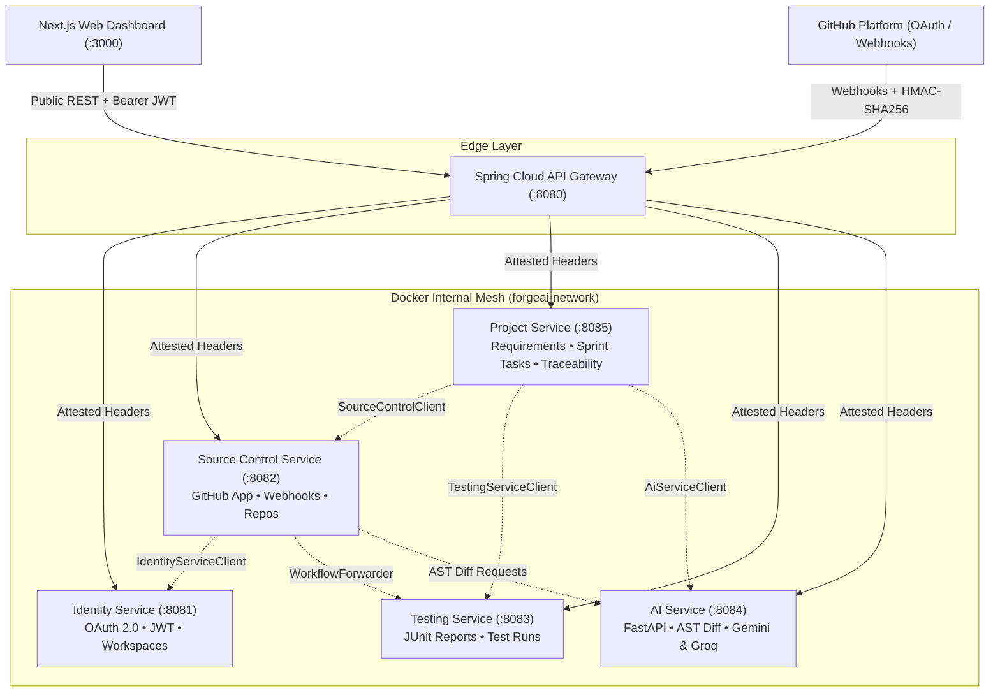

# Inter-Service Communication Architecture in ForgeAI

ForgeAI operates as a **Zero-Trust, Distributed Microservices Architecture** organized across two primary traffic planes:
1. **North-South Traffic (Ingress):** External requests from the browser/frontend dashboard or incoming GitHub webhooks routed through the **API Gateway** (`:8080`).
2. **East-West Traffic (Service-to-Service):** Direct synchronous and asynchronous communication among internal microservices over Docker's internal virtual bridge network (`forgeai-network`).

---

## 1. High-Level Architecture & Communication Topology



---

## 2. Transport & Network Routing (How Packets Travel)

All containers run inside the internal Docker network `forgeai-network`. Microservices communicate directly using **Docker service DNS names** rather than public IPs or `localhost`:

| Calling Microservice | Target Microservice | Internal Base URL | Purpose / Responsibilities |
| :--- | :--- | :--- | :--- |
| **API Gateway** | All Microservices | `http://<service-name>:<port>` | Routes authenticated frontend API calls dynamically |
| **Project Service** | Source Control Service | `http://source-control-service:8082` | Fetches commits, PRs, and repositories linked to sprint tasks |
| **Project Service** | Testing Service | `http://testing-service:8083` | Ingests JUnit test runs linked to requirement acceptance criteria |
| **Project Service** | AI Service | `http://ai-service:8084` | Queries blast radius scores and project engineering health |
| **Source Control** | Identity Service | `http://identity-service:8081` | Verifies user GitHub account connection and claims |
| **Source Control** | Testing Service | `http://testing-service:8083` | Forwards GitHub Actions CI workflow runs for test reporting |
| **Source Control** | AI Service | `http://ai-service:8084` | Submits pull request diffs for AST analysis & blast radius scoring |

### Client Libraries Used
* **Java Microservices (Spring Boot 3.2, Java 21):** Native non-blocking `java.net.http.HttpClient` configured with connection timeouts (4–5s) and strict request SLAs.
* **API Gateway (Reactive WebFlux):** Spring WebClient with non-blocking Netty engine.
* **AI Service (Python 3.11, FastAPI):** `httpx` and `requests`.

---

## 3. Zero-Trust Security & Internal Attestation Marker

To achieve microsecond inter-service performance without cryptographically re-verifying RSA JWT signatures on every internal hop, ForgeAI implements **Fail-Closed Internal Attestation**:

### Step 1: Gateway Strips Untrusted Headers
When an external HTTP request arrives at `GatewayTenantFilter.java`:
* It removes any client-submitted `X-User-Id`, `X-Workspace-Id`, `X-Org-Id`, `X-Organization-Id`, `X-Permissions`, or `X-ForgeAI-Internal` headers.
* This guarantees that external clients cannot spoof tenant identity.

### Step 2: Gateway & Calling Services Attach Attestation
Once authentication succeeds, the calling service injects internal context headers:
```http
X-ForgeAI-Internal: attested
X-User-Id: 387eca29-e35b-4a7e-b4ab-60aa91d2ed4e
X-Workspace-Id: 6144882a-147d-4a35-8b4f-4001a75ecb27
X-Workspace-Scope: PERSONAL
X-Correlation-Id: 139865df-a16b-4e44-b808-63a11a247090
traceparent: 00-139865dfa16b4e44b80863a11a247090-5b7d189e4f210a45-01
```

### Step 3: Target Service Validates Attestation
Inside downstream microservices, `TenantContextFilter.java` evaluates:
```java
@Value("${forgeai.security.enforce-internal-marker:true}")
private boolean enforceInternalMarker;

String attestation = request.getHeader("X-ForgeAI-Internal");
boolean isAttested = "attested".equalsIgnoreCase(attestation);

if (!enforceInternalMarker || isAttested) {
    // Populate ThreadLocal TenantContext for the current thread
    TenantContext.setUserId(UUID.fromString(request.getHeader("X-User-Id")));
    TenantContext.setWorkspaceId(UUID.fromString(request.getHeader("X-Workspace-Id")));
}
```
If an un-attested caller attempts to present internal tenant headers, they are ignored or rejected with `403 Forbidden` (`enforceInternalMarker: true`).

---

## 4. Concrete Code Example: East-West Request Construction

In `services/project-service/.../SourceControlClient.java`, when `project-service` needs commits for a task, it constructs an attested internal request:

```java
private HttpRequest buildRequest(String path, UUID workspaceId, UUID organizationId) {
    HttpRequest.Builder builder = HttpRequest.newBuilder()
            .uri(URI.create(baseUrl + path)) // e.g. http://source-control-service:8082/api/v1/repositories/...
            .header("Accept", "application/json")
            .header("X-ForgeAI-Internal", "attested")       // Attestation marker
            .header("X-Correlation-Id", correlationId)     // Correlation tracing
            .header("traceparent", traceparent)            // W3C trace propagation
            .timeout(Duration.ofSeconds(5))
            .GET();

    if (organizationId != null) {
        builder.header("X-Org-Id", organizationId.toString());
        builder.header("X-Workspace-Scope", "ORGANIZATION");
    } else if (workspaceId != null) {
        builder.header("X-Workspace-Id", workspaceId.toString());
        builder.header("X-Workspace-Scope", "PERSONAL");
    }

    UUID userId = TenantContext.getUserId();
    if (userId != null) {
        builder.header("X-User-Id", userId.toString());
    }

    return builder.build();
}
```

---

## 5. Fault Tolerance & In-Process Circuit Breakers

To prevent cascading system outages when a downstream service is updating or temporarily overloaded:
* Each client adapter (`SourceControlClient`, `TestingServiceClient`, `AiServiceClient`) implements an in-process **`SimpleCircuitBreaker`**.
* **Failure Threshold:** 3 consecutive HTTP timeouts or 5xx errors trigger the circuit to `OPEN`.
* **Fast-Fail:** Subsequent calls fail fast immediately without holding server threads or blocking incoming requests.
* **Probing:** After 30 seconds, it shifts to `HALF_OPEN` and sends 1 trial request to probe downstream health.
* **Graceful Degradation:** The calling service marks the data status as `UNAVAILABLE` rather than failing the overall user request or crashing the dashboard.

---

## 6. Distributed Observability (W3C `traceparent` & `X-Correlation-Id`)

Every request generated at the API Gateway receives:
* An **`X-Correlation-Id`** (e.g. UUID).
* A standard **W3C `traceparent`** (`00-{traceId}-{spanId}-01`).

Each microservice stores these identifiers in SLF4J's Mapped Diagnostic Context (`MDC`). When a service makes a downstream call, it passes the same `correlationId` and generates a child `spanId`. This allows engineers to grep a single correlation ID across all 5 Docker containers to see the complete distributed request lifecycle.
