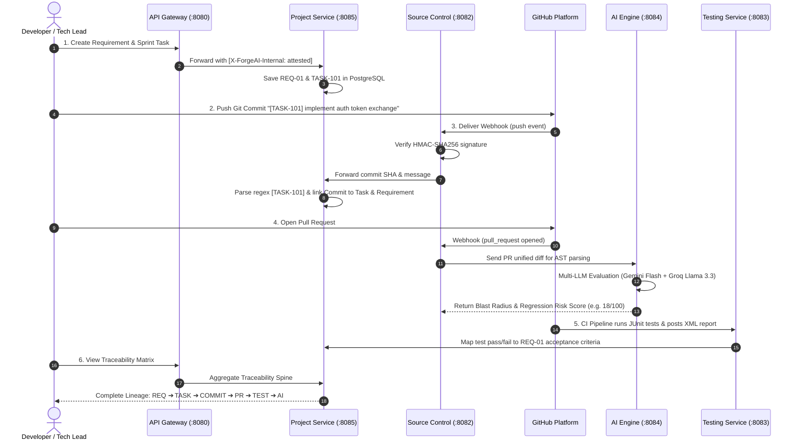

# How to Explain ForgeAI to an Interviewer: Complete Interview Playbook

When an interviewer asks: **"Tell me about your project"** or **"Explain your major project"**, they are evaluating:
1. **System Design & Architecture:** Can you design scalable, distributed, production-grade systems?
2. **Problem Solving & Real-World Relevance:** Are you solving an actual industry pain point or just building a generic CRUD app?
3. **Depth of Technical Ownership:** Do you understand the low-level trade-offs (security, networking, fault tolerance, databases)?
4. **Communication & Structuring:** Can you explain complex distributed concepts clearly and concisely?

---

## 🎯 1. The 30-Second Elevator Pitch (Quick Summary)

> *"ForgeAI is an Autonomous Engineering Governance Operating System designed for enterprise engineering teams. In most software companies, requirements live in Jira, code lives in GitHub, test results in CI runners, and architectural risk is evaluated manually. ForgeAI connects all these fragmented silos into a single, real-time **Traceability Spine**.*
>
> *Every business requirement is deterministically linked to sprint tasks, Git commits, GitHub Pull Requests, automated JUnit test runs, and an AI-powered code blast-radius analysis. It is built as a reactive microservices mesh using **Java 21, Spring Boot 3.2, Next.js 16, Python FastAPI with pgvector, PostgreSQL, and Redis**, secured with a zero-trust internal attestation architecture."*

---

## ⏱️ 2. The 2-Minute Structured Pitch (STAR Method)

Use the **STAR (Situation - Task - Action - Result)** framework for a balanced explanation:

### S — Situation (The Problem)
*"In enterprise software engineering, engineering leaders face an observability black hole. A product manager defines a requirement in Jira, developers write code in GitHub, Jenkins runs tests, and production bugs occur because nobody knows what changed, why it changed, or what tests were supposed to validate it. During compliance audits (like SOC 2 or ISO 27001), companies spend weeks manually mapping commits and PRs back to requirement tickets."*

### T — Task (Our Objective)
*"Our goal was to build an autonomous platform that provides 100% bidirectional traceability in real time: from requirement specification, to sprint task, to Git commit, to Pull Request, to CI test execution, all the way to predictive AI risk assessment."*

### A — Action (Architecture & What We Built)
*"To achieve this, we architected ForgeAI as an event-driven microservices platform:*
1. ***API Gateway (Spring Cloud WebFlux + Redis):*** *Handles rate limiting, JWT validation, and sanitizes untrusted incoming headers.*
2. ***Identity Service (Spring Boot 3 + PostgreSQL):*** *Manages multi-tenant organizations and personal workspaces with asymmetric RS256 JWT tokens and GitHub OAuth 2.0.*
3. ***Source Control Service (Spring Boot 3 + Flyway):*** *Integrates deeply with GitHub via a GitHub App. It verifies webhooks via HMAC-SHA256, auto-discovers repositories, and synchronizes branches, commits, and PRs without exposing manual numeric IDs.*
4. ***Project Service:*** *Maintains sprint backlogs, requirements, and aggregates the Traceability Spine.*
5. ***Testing Service:*** *Ingests JUnit test XML reports and correlates test pass/fail results directly against requirement acceptance criteria.*
6. ***AI Reliability Engine (Python FastAPI + Gemini & Groq):*** *Performs Abstract Syntax Tree (AST) unified diff parsing on PRs to calculate code churn and architectural blast radius risk scores (0–100).*
7. ***Frontend (Next.js 16 + Tailwind CSS):*** *A high-density Carbon/Linear-inspired dark UI with real-time sync pills and Kanban boards.*

*For security, we built a **fail-closed internal attestation mesh**: internal microservices reject spoofed tenant headers unless tagged with an internal cryptographic marker (`X-ForgeAI-Internal: attested`) signed by the gateway."*

### R — Result (Impact & Verification)
*"The platform allows an engineering team to trace any production commit back to its approved requirement in sub-second time, view the exact JUnit test suites that validated it, and inspect the AI blast-radius risk before code merges. The system is fully containerized across 9 Docker services with W3C distributed tracing (`traceparent`) and automated test suites."*

---

## 🏛️ 3. The 5-Minute Technical Deep Dive (Architecture Walkthrough)

If the interviewer says: *"Walk me through the system architecture and how data flows"*, draw or explain this sequence:

---

## 🌟 4. Top Technical Highlights to Mention (Senior Signals)

Highlighting these specific engineering decisions will make you stand out from average candidates:

### 1. Zero-Trust Internal Attestation (`X-ForgeAI-Internal: attested`)
* **Interview Point:** *"In a microservices architecture, you can't re-verify RSA JWT signatures on every internal HTTP call without introducing severe latency. But trusting internal headers (`X-User-Id`, `X-Workspace-Id`) blindly allows header spoofing.*
* **Our Solution:** *Our API Gateway strips all client headers upon ingress. If the JWT is valid, it injects an internal marker: `X-ForgeAI-Internal: attested`. Downstream services have a `TenantContextFilter` that operates in a **fail-closed** mode (`enforce-internal-marker: true`). Any request arriving without this attestation is rejected with `403 Forbidden`."*

### 2. Multi-Tenant vs. Personal Workspace Isolation
* **Interview Point:** *"We designed a dual-scope workspace model:*
  * *`PERSONAL` Scope (`organization_id = NULL`): Individual developers can connect private GitHub accounts and personal repositories without creating an organization.*
  * *`ORGANIZATION` Scope (`organization_id = UUID`): Teams have collaborative RBAC access.*
* *At the database layer, check constraints (`chk_repo_scope`, `chk_gh_install_scope`) guarantee that User A can never query, enumerate, or access User B's repositories, returning `404 Not Found` rather than leaking resource existence."*

### 3. Cryptographic Anti-Replay GitHub App Onboarding
* **Interview Point:** *"Instead of having developers manually copy numeric GitHub App installation IDs into our UI, we engineered a single-click OAuth + App installation flow.*
* *To prevent CSRF and token injection, our backend generates a 256-bit cryptographically secure state token with a 15-minute TTL bound to the user ID and workspace ID. Upon callback from GitHub, this state token is consumed atomically in the database. Any replayed or forged request is instantly blocked."*

### 4. Hybrid Multi-LLM Blast Radius Engine
* **Interview Point:** *"Rather than using a single generic LLM, we implemented a specialized hybrid pipeline in our Python FastAPI service:*
  * *`Google Gemini 1.5 Flash` for fast, lightweight contextual AST token embeddings and similarity indexing with `pgvector`.*
  * *`Groq (Llama 3.3 70B Versatile)` for ultra-low latency semantic reasoning over code churn, calculating architectural regression risk scores (0–100) and identifying uncovered edge cases."*

### 5. Resilient Inter-Service Communication & Fault Tolerance
* **Interview Point:** *"Services communicate over Docker's internal DNS using native Java 21 `HttpClient` with strict 5-second timeouts. To prevent cascading failures when a downstream microservice is restarting, we implemented an in-process **Circuit Breaker** (`SimpleCircuitBreaker`) that trips to `OPEN` after 3 consecutive failures, fast-fails during outages, and probes downstream health after 30 seconds."*

---

## 💡 5. Likely Follow-Up Questions & Model Answers

### Q1: *"Why did you choose a microservices architecture instead of a monolith?"*
**Answer:**
> *"ForgeAI has heterogeneous operational profiles:*
> * *The **Core Domain services** (Identity, Source Control, Project, Testing) require high transactional consistency, relational integrity, and enterprise typing, where Java 21 and Spring Boot 3 excel.*
> * *The **AI Reliability Engine** requires deep access to ML ecosystems, AST parsers, vector mathematics (`pgvector`), and LLM SDKs, where Python and FastAPI are the industry standard.*
> * *The **API Gateway** needs reactive non-blocking I/O to handle thousands of concurrent WebSocket/SSE connections and Redis rate limiting.*
> * *Breaking these into discrete services allows independent scaling, isolated failure domains, and technology-optimized runtimes."*

### Q2: *"How do you handle distributed transactions across services?"*
**Answer:**
> *"We avoid distributed 2-Phase Commit (2PC) locks because they kill scalability. Instead, we use the **Transactional Outbox Pattern** combined with idempotent REST updates.*
> *When a domain event occurs (such as `RepositoryConnectedEvent`), the event is persisted inside the same local database transaction as the repository record in an `outbox_events` table. An asynchronous background dispatcher then publishes the event downstream. Every receiving service is designed to be idempotent (using upserts or SHA/UUID deduping), ensuring eventual consistency with zero distributed locking."*

### Q3: *"How do you trace a single request through all these microservices?"*
**Answer:**
> *"We implemented the **W3C Distributed Tracing standard**. When a request hits our API Gateway, it assigns an `X-Correlation-Id` and a `traceparent` header (`00-{traceId}-{spanId}-01`). Every microservice reads this into SLF4J's Mapped Diagnostic Context (MDC) and forwards it on every outbound HTTP request. In our log aggregator, searching for a single correlation ID shows the entire journey across the Gateway, Identity, Source Control, and Project services."*

### Q4: *"What was the most challenging bug you encountered and how did you solve it?"*
**Answer:**
> *"One of our toughest challenges was an **organization versus workspace UUID mismatch in source-control-service**. In our identity service, organization workspaces have distinct workspace UUIDs from their parent organization UUIDs. When our frontend passed both the org header and workspace query parameter, source-control-service attempted to validate the workspace against its local table, which lacked an organization projection, causing a `400 Bad Request`.*
> *We resolved it by analyzing our PostgreSQL check constraints (`chk_repo_scope`), which require `workspace_id = organization_id` for organizational scope. We refactored `resolveEffectiveWorkspaceId` across the application services to inspect tenant scope and normalize the effective workspace ID to `organizationId` for persistence while maintaining personal workspace isolation."*

---

## 📋 6. Cheat Sheet Summary Table

| Question Area | Your Key Talking Point |
| :--- | :--- |
| **What is it?** | Autonomous Engineering Governance Matrix linking REQ ➔ TASK ➔ COMMIT ➔ PR ➔ TEST ➔ AI. |
| **Tech Stack** | Java 21, Spring Boot 3.2, Next.js 16 (Turbopack), Python 3.11 (FastAPI), PostgreSQL 16 + pgvector, Redis 7, Docker. |
| **Security** | Zero-Trust internal marker (`X-ForgeAI-Internal: attested`), RS256 JWT, single-use anti-replay tokens, HMAC-SHA256 webhooks. |
| **AI Integration** | AST diffing, Google Gemini 1.5 Flash + Groq Llama 3.3 70B, 0–100 regression risk scoring, pgvector embeddings. |
| **Resilience** | In-process Circuit Breakers (3-strike trip, 30s probe), graceful fallback to `UNAVAILABLE` status, W3C tracing. |
| **Multi-Tenancy** | Dual-scope (`PERSONAL` vs `ORGANIZATION`) with database-enforced row isolation. |
