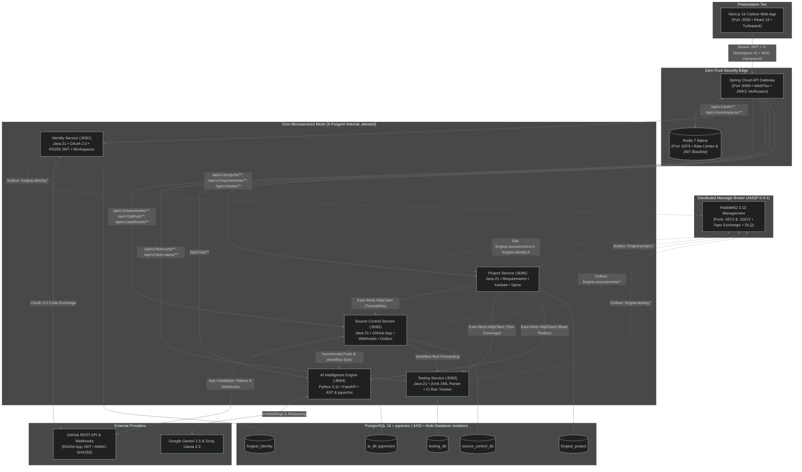
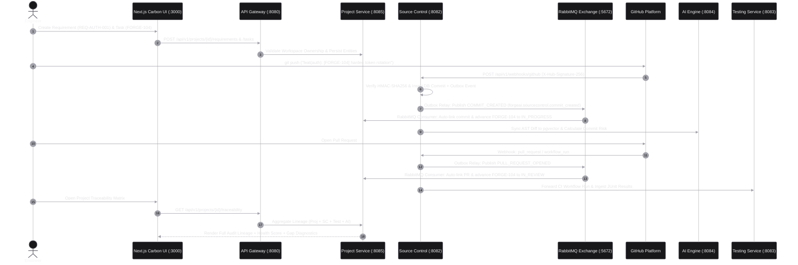

<div align="center">

# ⚡ ForgeAI

### The Autonomous Engineering Governance & Traceability Operating System

**Bridge product requirements, sprint execution, GitHub source control, CI test verification, and multi-LLM blast-radius intelligence into a single cryptographically attested spine.**

<br/>

[](https://openjdk.org/)
[](https://spring.io/projects/spring-boot)
[](https://nextjs.org/)
[](https://react.dev/)
[](https://www.rabbitmq.com/)
[](https://www.postgresql.org/)
[](https://redis.io/)
[](https://fastapi.tiangolo.com/)
[](https://www.docker.com/)
[](LICENSE)

</div>

<br/>

> **The Engineering Silo Problem:** Product specs live in Jira or Linear. Code lives in GitHub. Test results live in CI logs. Risk assessment happens in ad-hoc PR comments—or during a 2:00 AM post-mortem.
>
> **The ForgeAI Solution:** Every code change is deterministically linked from its originating **Requirement** and **Sprint Task** down to the exact **Git Commit**, **Pull Request**, **JUnit Test Suite**, **AI Blast-Radius Score**, and **Remediation PR**—enforced continuously via an **AMQP Event Mesh** and transactional outboxes.

```text
┌───────────────┐    ┌───────────────┐    ┌───────────────┐    ┌───────────────┐    ┌───────────────┐    ┌──────────────────┐
│  REQUIREMENT  │ ──▶│  SPRINT TASK  │ ──▶│  GIT COMMIT   │ ──▶│ PULL REQUEST  │ ──▶│  CI TEST RUN  │ ──▶│ AI BLAST RADIUS  │
│  REQ-AUTH-01  │    │   FORGE-104   │    │   sha:71ebe13 │    │     PR #42    │    │  JUnit / GHA  │    │ Risk Score & Fix │
└───────────────┘    └───────────────┘    └───────────────┘    └───────────────┘    └───────────────┘    └──────────────────┘
```

---

## ⚡ Why ForgeAI vs. Traditional AI Coding Tools

Standard AI IDEs (Cursor, Copilot, Claude Code) help individual developers write lines of code faster on their laptop—but they have zero visibility into whether that code satisfies business requirements, breaks downstream repositories, or passes organizational governance gates.

| Dimension | Traditional AI IDEs (Cursor / Copilot) | Project Trackers (Jira / Linear) | **ForgeAI Operating System** |
| :--- | :--- | :--- | :--- |
| **Primary Scope** | Local file & prompt editing | Manual ticket status updates | **End-to-end autonomous engineering governance** |
| **Requirement-to-Code Lineage** | None | Manual copy-pasting of PR links | **Deterministic bidirectional Traceability Spine** |
| **Blast-Radius & Cross-Repo Impact** | Limited to open local workspace | None | **pgvector semantic AST graph + cross-repo impact engine** |
| **Automated Test Verification** | Local terminal execution | None | **Real-time GitHub Actions & JUnit XML requirement mapping** |
| **Event Choreography & Outbox** | None | Ad-hoc webhooks | **Transactional Outbox + RabbitMQ Topic Exchange & DLQ Mesh** |
| **Security & Remediation Loop** | Suggests snippets in chat | Passive issue tracking | **Autonomous secret/CVE scan + 1-click Remediation PRs** |
| **Multi-Tenant Isolation** | Single-user local client | Shared SaaS workspace | **Fail-closed Gateway attestation + DB check constraints** |

---

## ✨ Core Platform Pillars

### 1. 🧬 Deterministic 10-Stage Traceability Spine
- **Bidirectional Audit Lineage:** Traverse forward from any business requirement (`REQ-001`) to every implementing task, branch, commit, pull request, test case, and AI risk report—or backward from a production commit SHA to the exact product specification that authorized it.
- **Zero-Touch Git Activity Sync:** Webhook and event-driven consumers parse task keys (`[FORGE-104]`, `Fixes PROJ-12`) from commit messages, branch names, and PR descriptions, automatically progressing Kanban cards (`TODO ➔ IN_PROGRESS ➔ IN_REVIEW ➔ DONE`).
- **Immutable Compliance Snapshots:** Capture point-in-time JSON snapshots (`TraceabilitySnapshot`) with gap-detection diagnostics (`ORPHAN_REQUIREMENT`, `TASK_WITHOUT_CODE`, `REQUIREMENT_WITHOUT_TEST`) ready for SOC 2 and ISO 27001 audits.

### 2. 🐇 RabbitMQ AMQP 0-9-1 Topic Exchange & Dead-Letter Queue (DLQ) Mesh
- **Transactional Outbox Dual-Dispatch:** State changes and domain events commit atomically into PostgreSQL (`outbox_events`). Outbox relays dispatch events both in-process to Spring `ApplicationEventPublisher` and over AMQP to `forgeai.events.exchange`.
- **Decoupled Cross-Service Choreography:** Microservices publish and subscribe to domain topics (e.g. `forgeai.sourcecontrol.commit_created`, `forgeai.identity.user_created`).
- **Fail-Safe Poison Message Handling:** Every queue binds to a dedicated Dead-Letter Exchange (`forgeai.events.dlx`) and Dead-Letter Queue (`forgeai.events.dlq`) to isolate unprocessable messages without dropping data or blocking worker threads.

### 3. 🧠 Hybrid AI Code Intelligence & Blast-Radius Engine
- **Semantic AST Chunking & Vector Graph:** Indexes repository source code into PostgreSQL `pgvector` embeddings alongside an explicit symbol dependency graph (`code_chunks` + `graph_edges`).
- **Dual-Provider LLM Orchestration:** Combines **Google Gemini (`gemini-1.5-flash` / `text-embedding-004`)** for high-throughput semantic retrieval with **Groq (`llama-3.3-70b-versatile`)** for low-latency architectural reasoning and failover resilience.
- **Multi-Dimensional Risk Scoring (0–100):** Evaluates pull requests and commits across security vulnerabilities, secret exposure, dependency CVEs, test coverage gaps, and downstream blast radius.
- **1-Click Autonomous Remediation PRs:** Generates concrete code patches, missing JUnit test suites, and architecture documentation (`README.md`, `ARCHITECTURE.md`, `API_REFERENCE.md`), committing branches and opening GitHub Pull Requests directly via the ForgeAI GitHub App.

### 4. 🔗 Frictionless GitHub App & Webhook Mesh
- **Unified Single-Click Onboarding:** Orchestrates GitHub OAuth 2.0 identity linking and GitHub App installation (`GET /api/v1/github/connection`) without ever asking users to copy-paste numeric installation IDs or personal access tokens.
- **Auto-Resolved App Metadata:** Dynamically queries `GET https://api.github.com/app` using RS256-signed App JWTs to resolve the live GitHub App slug and installation state.
- **Cryptographic Single-Use State Tokens:** Protects installation callbacks with 256-bit `SecureRandom` state tokens (`github_installation_states`, 15-minute TTL) consumed atomically to prevent CSRF, replay, and cross-user installation hijacking.
- **Instant Sync & Disconnect Controls:** Connecting a repository immediately synchronizes commits, pull requests, workflow runs, and AI code indexing, with per-repository **Sync** and **Disconnect** controls in the UI.

### 5. 🛡️ Defense-in-Depth Multi-Tenant Isolation
- **Dual Workspace Model:** Supports both **Personal Workspaces** (`scope = 'PERSONAL'`, `organization_id IS NULL`) for individual builders and **Organization Workspaces** (`scope = 'ORGANIZATION'`, `workspace_id = organization_id`) for enterprise teams.
- **Fail-Closed Internal Gateway Attestation:** The reactive Spring Cloud Gateway strips all inbound `X-User-Id`, `X-Org-Id`, and `X-Workspace-Id` headers from external clients, validates the RS256 JWT against Identity Service JWKS (`/.well-known/jwks.json`), verifies active Redis token revocation state, and injects `X-ForgeAI-Internal: attested`.
- **Database-Enforced Invariants:** PostgreSQL `CHECK` constraints (`chk_repo_scope`, `chk_gh_install_scope`, `chk_pr_tenant`, `chk_commits_tenant`, `chk_sc_outbox_scope`) guarantee tenant boundaries even at the raw SQL layer.

### 6. 🎨 Linear / Vercel Carbon Design System
- **High-Contrast Carbon Palette:** Built with Next.js 16, React 19, Tailwind CSS, and Lucide icons using `#09090b` canvas surfaces, `#111113` micro-panels, and `#222226` hairline borders.
- **Sanitized User-Facing Diagnostics:** Centralized error sanitization (`sanitizeUserFacingError` in `api-client.ts` + global exception handlers across all Java and Python services) guarantees users never see raw stack traces, SQL constraints, or internal UUIDs.

---

## 🏗️ Distributed System Architecture

ForgeAI runs as a **10-container event-driven system** with isolated PostgreSQL databases per bounded context, RabbitMQ topic exchange mesh, transactional outbox relays, and a reactive WebFlux API Gateway:



---

## 🔄 End-to-End Event-Driven Traceability Sequence



---

## 📦 Microservice Catalog

| Service | Container Name | Port | Stack | Dedicated Database | Key Responsibilities |
| :--- | :--- | :--- | :--- | :--- | :--- |
| **Web Dashboard** | `forgeai-frontend-dev` | `3000` | Next.js 16, React 19, Tailwind | Browser Storage | Carbon UI, 1-click GitHub onboarding, Kanban board, AI Test Studio, Traceability Matrix. |
| **API Gateway** | `forgeai-api-gateway-dev` | `8080` | Java 21, Spring Cloud Gateway | Redis 7 (`:6379`) | RS256 JWKS verification, Redis token revocation check, rate limiting, `X-ForgeAI-Internal` attestation. |
| **Identity Service** | `forgeai-identity-dev` | `8081` | Java 21, Spring Boot 3.2 | `forgeai_identity` | User auth, GitHub OAuth 2.0, RS256 JWT rotation, Personal & Org Workspaces, Outbox event publishing. |
| **Source Control** | `forgeai-source-control-dev` | `8082` | Java 21, Spring Boot 3.2 | `source_control_db` | GitHub App JWT manager, HMAC webhooks, commit/PR sync, Outbox event publishing to AMQP exchange. |
| **Testing Service** | `forgeai-testing-dev` | `8083` | Java 21, Spring Boot 3.2 | `testing_db` | JUnit XML parser, GitHub Actions workflow run ingestion, requirement-to-test coverage mapping. |
| **AI Service** | `forgeai-ai-dev` | `8084` | Python 3.11, FastAPI, `asyncpg` | `ai_db` (`pgvector`) | AST chunking, vector search, PR blast-radius scoring, secret scanning, AI Sprint Planner & Test Studio. |
| **Project Service** | `forgeai-project-dev` | `8085` | Java 21, Spring Boot 3.2 | `forgeai_project` | Governed projects, requirements, Kanban tasks, RabbitMQ event consumer, Traceability Spine aggregation. |
| **RabbitMQ 3.13** | `forgeai-rabbitmq-dev` | `5672`, `15672` | RabbitMQ Alpine (Erlang 26) | Mnesia Volume | AMQP Topic Exchange (`forgeai.events.exchange`), Dead-Letter Queues, Management Web UI. |
| **PostgreSQL 16** | `forgeai-postgres-dev` | `5432` | `pgvector/pgvector:pg16` | 5 Isolated DBs | Relational persistence, Flyway schema migrations, and 768-dim vector similarity indexing. |
| **Redis 7** | `forgeai-redis-dev` | `6379` | `redis:7-alpine` (AOF) | In-Memory + AOF | Sliding-window gateway rate limiting, role caching, and revoked JWT blacklisting. |

---

## 🔒 Security Architecture & Threat Mitigations

| Threat Scenario | Attack Vector | ForgeAI Defense-in-Depth Control |
| :--- | :--- | :--- |
| **Header Spoofing / Privilege Escalation** | Client sends forged `X-User-Id` or `X-Org-Id` headers | `GatewayTenantFilter` strips all inbound identity/tenant headers before JWT decoding, then attaches `X-ForgeAI-Internal: attested`. Downstream filters enforce `@Value("${forgeai.security.enforce-internal-marker:true}")`. |
| **GitHub Installation Hijacking** | User B replays or guesses User A's `installation_id` | `GitHubInstallationStateService` issues single-use 256-bit state tokens (15-min TTL), and `GitHubInstallationDiscoveryService` verifies that the GitHub App installation's `accountId`/`accountLogin` matches the caller's linked OAuth identity. |
| **Cross-Workspace Snooping** | Active Org header (`X-Org-Id`) leaks into Personal Workspace queries | `TenantProvider` clears `X-Org-Id` in Personal Workspaces, and backend services validate `workspace.ownerUserId == callerUserId` before returning personal projects or repositories. |
| **Webhook Forgery & Replay** | Attacker posts fabricated push/PR payloads to `/api/v1/webhooks/github` | `GitHubSignatureVerifier` validates `X-Hub-Signature-256` using constant-time HMAC-SHA256 comparison, and `webhook_deliveries` enforces idempotency on `X-GitHub-Delivery`. |
| **Database Scope Corruption** | Buggy code attempts to mix Personal and Org tenant columns | PostgreSQL check constraints (`chk_repo_scope`, `chk_gh_install_scope`, `chk_project_workspace_scope`) reject any row where `PERSONAL` scope has a non-null `organization_id` or `ORGANIZATION` scope mismatches `workspace_id = organization_id`. |
| **Poison Message & Broker Starvation** | Malformed event crashes message consumer repeatedly | Bound to Dead-Letter Exchange `forgeai.events.dlx`; failed messages move safely to `forgeai.events.dlq` without blocking worker threads. |
| **Exception & Stack-Trace Leakage** | Runtime SQL/Java/Python errors bubble up to the browser | `GlobalExceptionHandler` across all Java services, FastAPI exception handlers in `ai-service`, and `sanitizeUserFacingError()` in `api-client.ts` log technical details server-side while returning clean, human-friendly messages to the UI. |

---

## 🚀 Quick Start

### Prerequisites

- **Docker Desktop** (Docker Engine 24+ & Docker Compose v2)
- **Git** (and optionally **Java 21**, **Maven 3.9+**, **Node.js 20+**, and **Python 3.11+** for local host builds)

### 1. Clone & Configure Environment

```bash
git clone https://github.com/rajpagare01/ForgeAI.git
cd ForgeAI
cp .env.example .env
```

Update `.env` with your GitHub App, GitHub OAuth, RabbitMQ, and LLM API credentials:

```env
# --- PostgreSQL & Redis ---
POSTGRES_USER=forgeai
POSTGRES_PASSWORD=password

# --- RabbitMQ Message Broker ---
RABBITMQ_USER=forgeai
RABBITMQ_PASSWORD=password
RABBITMQ_HOST=rabbitmq
RABBITMQ_PORT=5672
RABBITMQ_MANAGEMENT_PORT=15672

# --- GitHub OAuth (Identity Service :8081) ---
GITHUB_CLIENT_ID=your-github-oauth-client-id
GITHUB_CLIENT_SECRET=your-github-oauth-client-secret

# --- GitHub App & Webhooks (Source Control Service :8082) ---
GITHUB_APP_ID=123456
GITHUB_APP_SLUG=your-github-app-slug
GITHUB_WEBHOOK_SECRET=your-github-webhook-secret
GITHUB_PRIVATE_KEY_PATH=/app/secrets/github-app-private-key.pem

# --- AI Intelligence Engine (AI Service :8084) ---
GEMINI_API_KEY=your-gemini-api-key
GEMINI_MODEL=gemini-1.5-flash
GEMINI_EMBEDDING_MODEL=models/text-embedding-004
GROQ_API_KEY=your-groq-api-key
GROQ_MODEL=llama-3.3-70b-versatile
```

Place your GitHub App RSA private key (`.pem`) inside `./secrets/`:

```bash
mkdir -p secrets
cp /path/to/your-github-app.private-key.pem secrets/github-app-private-key.pem
```

### 2. Launch the Full Stack

```bash
docker compose -f docker-compose.dev.yml up -d --build
```

Check that all 10 containers report `Up (healthy)`:

```bash
docker ps --format "table {{.Names}}\t{{.Status}}\t{{.Ports}}"
```

```text
NAMES                        STATUS         PORTS
forgeai-frontend-dev         Up (healthy)   0.0.0.0:3000->3000/tcp
forgeai-api-gateway-dev      Up (healthy)   0.0.0.0:8080->8080/tcp
forgeai-identity-dev         Up (healthy)   0.0.0.0:8081->8081/tcp
forgeai-source-control-dev   Up (healthy)   0.0.0.0:8082->8082/tcp
forgeai-testing-dev          Up (healthy)   0.0.0.0:8083->8083/tcp
forgeai-ai-dev               Up (healthy)   0.0.0.0:8084->8084/tcp
forgeai-project-dev          Up (healthy)   0.0.0.0:8085->8085/tcp
forgeai-rabbitmq-dev         Up (healthy)   0.0.0.0:5672->5672/tcp, 0.0.0.0:15672->15672/tcp
forgeai-postgres-dev         Up (healthy)   0.0.0.0:5432->5432/tcp
forgeai-redis-dev            Up (healthy)   0.0.0.0:6379->6379/tcp
```

### 3. Access Endpoints & Health Checks

| Endpoint | URL | Purpose |
| :--- | :--- | :--- |
| **ForgeAI Web Dashboard** | `http://localhost:3000` | Main Next.js 16 Carbon UI |
| **RabbitMQ Management UI** | `http://localhost:15672` | AMQP Exchanges, Queues, DLQ Telemetry (`forgeai`/`password`) |
| **API Gateway Health** | `http://localhost:8080/actuator/health` | Edge gateway & Redis connectivity |
| **Identity Service Health** | `http://localhost:8081/actuator/health` | Auth, JWKS (`/.well-known/jwks.json`), Workspaces |
| **Source Control Health** | `http://localhost:8082/api/v1/github/health` | GitHub App configuration & installation status |
| **Testing Service Health** | `http://localhost:8083/actuator/health` | JUnit & CI test run service |
| **AI Service Health** | `http://localhost:8084/healthz` | pgvector DB pool + Gemini/Groq provider status |
| **Project Service Health** | `http://localhost:8085/actuator/health` | Projects, Kanban tasks & Traceability Spine |

---

## 🧪 Verification & Test Suite

Run the full verification suite across all backend services and the frontend bundle:

```bash
# 1. Compile & test all Java microservices
mvn test-compile -f pom.xml

# 2. Run adversarial security & lifecycle test suites
mvn test -f services/source-control-service/pom.xml -Dtest=GitHubInstallationLifecycleSecurityTest
mvn test -f services/project-service/pom.xml -Dtest=WorkspaceSecurityAndIntegrityE2ETest

# 3. Run AI Service test suite
pytest services/ai-service/tests

# 4. Run Frontend TypeScript validation & production build
cd frontend && npm run build
```

---

## 📚 Deep-Dive Architecture Guides

Detailed architectural blueprints, design decisions, and interview pitches are available in the [`Aboutproject/`](./Aboutproject) directory:

- [**RabbitMQ AMQP Event Mesh & Dead-Letter Queue Architecture**](./Aboutproject/rabbitmq-event-mesh-architecture.md): Deep-dive into topic exchange bindings, transactional outbox dual-dispatch, and poison message handling.
- [**How Services Communicate in ForgeAI**](./Aboutproject/how-services-communicate.md): Complete guide to synchronous REST vs asynchronous AMQP communication across North-South and East-West traffic planes.
- [**Why Native `HttpClient` Over Spring Cloud OpenFeign**](./Aboutproject/openfeign-vs-httpclient-communication.md): In-depth benchmark and architectural rationale for choosing non-blocking Java 21 `HttpClient` with in-process circuit breakers.
- [**Project Interview Pitch Guide**](./Aboutproject/project-interview-pitch-guide.md): Complete executive pitch, technical FAQs, and architectural defense for engineering interviews.

---

## 🗂️ Monorepo Structure

```text
ForgeAI/
├── Aboutproject/                          # Comprehensive Architectural & Design Documentation
│   ├── how-services-communicate.md        #   Inter-Service Communication (Sync & Async)
│   ├── rabbitmq-event-mesh-architecture.md#   RabbitMQ 3.13 AMQP Topic Exchange & DLQ Mesh
│   ├── openfeign-vs-httpclient-communication.md # Why HttpClient over OpenFeign
│   └── project-interview-pitch-guide.md   #   System Design Interview Pitch & Defense Guide
├── frontend/                              # Next.js 16 + React 19 Carbon Web Application
│   ├── src/app/(dashboard)/               # Dashboard routes:
│   │   ├── page.tsx                       #   Executive Command Center & Telemetry
│   │   ├── repositories/page.tsx          #   1-Click GitHub Onboarding, Sync & Disconnect
│   │   ├── projects/page.tsx              #   Governed Projects, AI Sprint Planner & Kanban
│   │   ├── projects/[projectId]/          #   Project Board & Traceability Spine Matrix
│   │   ├── test-runs/page.tsx             #   CI Test Runs, AI Failure Diagnosis & Test Studio
│   │   ├── ai-insights/page.tsx           #   PR Blast Radius, Security Scan & Doc Generator
│   │   └── operations/page.tsx            #   Outbox Telemetry, Circuit Breakers & Health
│   ├── src/components/                    # Carbon UI primitives, Traceability Spine & Navigation
│   └── src/lib/                           # Gateway API client (error sanitizer + JWT refresh)
├── infrastructure/
│   └── api-gateway/                       # Spring Cloud Gateway (JWKS, Redis rate limit, tenant filter)
├── services/
│   ├── identity-service/                  # OAuth 2.0, RS256 JWTs, RBAC, Personal & Org Workspaces
│   ├── source-control-service/            # GitHub App client, webhooks, commit poller & PR proposer
│   ├── project-service/                   # Requirements, tasks, RabbitMQ consumer & Traceability aggregator
│   ├── testing-service/                   # JUnit XML ingestion, workflow run tracking & coverage
│   └── ai-service/                        # FastAPI, pgvector indexing, Gemini/Groq & remediation
├── scripts/docker/                        # Multi-PostgreSQL database initialization scripts
├── docker-compose.dev.yml                 # Local development stack (10 containers)
├── docker-compose.prod.yml                # Production-hardened stack with resource limits
└── pom.xml                                # Root Maven multi-module reactor
```

---

## 🗺️ Roadmap & Version 2.0 Vision

ForgeAI v1.0 establishes the complete 10-stage Traceability Spine, multi-tenant zero-trust security mesh, RabbitMQ event mesh, and multi-LLM blast-radius engine. **ForgeAI v2.0** expands the platform into an active, in-browser AI engineering studio and CI/CD enforcement plane:

| Milestone | Target | Version 2.0 Capability | Architectural Impact |
| :--- | :--- | :--- | :--- |
| **v2.0-M1** | **In-Browser AI Code & Diff Studio** | Embedded Monaco code explorer (`/repositories/[repoId]`) with recursive Git tree navigation, multi-file AST search, inline AI refactoring, and 1-click branch/PR commits directly from the browser. | Eliminates context-switching between the governance dashboard and a local IDE for rapid hotfixes and test authoring. |
| **v2.0-M2** | **Autonomous GitHub Check-Run Merge Gatekeeper** | Bi-directional GitHub Checks API integration (`POST /repos/{owner}/{repo}/check-runs`) that automatically blocks or approves Pull Requests on GitHub based on requirement test coverage, blast-radius thresholds, and zero-secret policies. | Elevates ForgeAI from an observability matrix into an active, cryptographically enforced merge gate on GitHub. |
| **v2.0-M3** | **Ephemeral Sandbox Test Runner** | Isolated, short-lived container workers that execute AI-generated JUnit / Pytest / Vitest suites against PR branches in a sandboxed runtime before proposing a remediation PR. | Guarantees that 100% of AI-generated remediation patches and test suites compile and pass before a human reviewer ever sees them. |
| **v2.0-M4** | **Multi-Provider VCS & Issue Federation** | Native connectors for **GitLab**, **Bitbucket**, **Jira**, and **Linear** via unified webhook adapters alongside OpenTelemetry distributed trace ingestion from production clusters. | Extends the Traceability Spine all the way to live production runtime telemetry (`Requirement ➔ Code ➔ Test ➔ Production Span`). |

---

## 👥 Authors & Acknowledgments

- **Raj Pagare** ([@rajpagare01](https://github.com/rajpagare01)) — *Lead Architect & Full-Stack Distributed Systems Engineer*
- **ForgeAI Core Engineering** — *Enterprise AI Engineering Operating System (2026)*

---

## 📄 License

Licensed under the **Apache License 2.0**. See `LICENSE` for full details.
