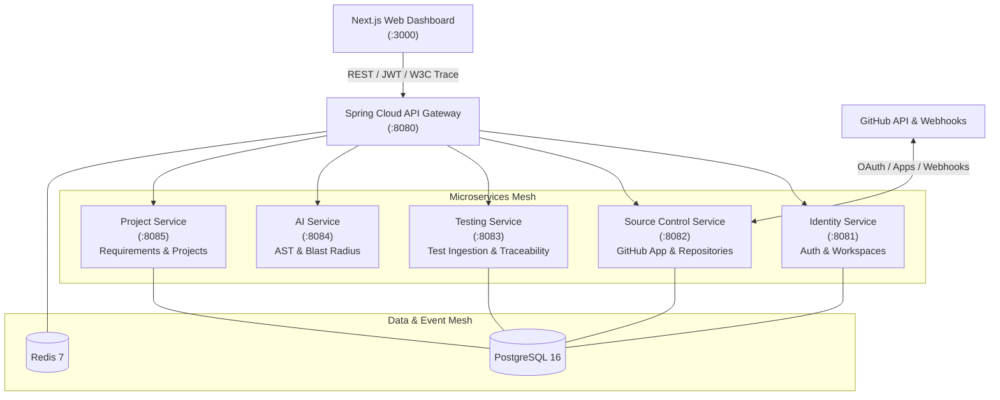

# ForgeAI — Autonomous Enterprise Engineering Governance & AI Operating System

[](https://www.docker.com/)
[](https://openjdk.org/)
[](https://spring.io/projects/spring-boot)
[](https://nextjs.org/)
[](https://www.python.org/)
[](https://www.postgresql.org/)
[](https://redis.io/)

ForgeAI is an enterprise-grade AI Engineering Operating System and Governance Matrix. It bridges modern developer workflows with automated end-to-end traceability, connecting sprint requirements, code commits, pull requests, automated test runs, and AI architectural health assessments into a unified traceability spine.

---

## 🌟 Key Highlights & Architecture

- **Unified One-Click GitHub Connection:** Frictionless GitHub App onboarding combining GitHub OAuth identity linking with GitHub App installation. Automatically discovers installations, persists associations, and verifies webhook signatures with zero manual installation IDs.
- **Strict Multi-Tenant & Personal Workspace Isolation:** Complete support for both enterprise organizations and personal developer workspaces (`organization_id = NULL`). Strict isolation guarantees that no user can access, enumerate, or spoof repositories across workspaces.
- **Traceability Spine (`REQ -> TASK -> PR -> COMMIT -> TEST -> AI`):** Complete bidirectional audit trail mapping requirements to code modifications, JUnit test runs, and blast radius risk scores.
- **AI-Powered Code Intelligence & Blast Radius:** Semantic AST diff analysis, regression risk prediction, and automated test impact analysis.
- **Enterprise Security & Observability:** RS256 JWT tokens, single-use anti-replay installation states, distributed W3C trace correlation (`traceparent`, `X-Correlation-Id`), and Redis rate limiting.

---

## 📐 Architecture & Services

ForgeAI is architected as an event-driven, reactive microservices platform orchestrated via Docker Compose:



### Microservice Catalog

| Service | Port | Technology | Primary Responsibilities |
| :--- | :--- | :--- | :--- |
| **API Gateway** | `8080` | Spring Cloud Gateway (Reactive) | JWT verification, route aggregation, rate limiting, CORS, tenant header validation |
| **Frontend Dashboard** | `3000` | Next.js 16 (Turbopack), Tailwind CSS | Platform workspace UI, one-click GitHub connect, project boards, traceability matrices |
| **Identity Service** | `8081` | Spring Boot 3, Spring Security | User authentication, RS256 JWT issuance, GitHub OAuth 2.0 identity linking, workspace lifecycle |
| **Source Control** | `8082` | Spring Boot 3, Flyway (V9) | GitHub App integration, cryptographic single-use installation callback, branch/commit sync, PR governance |
| **Testing Service** | `8083` | Spring Boot 3, PostgreSQL | JUnit test report ingestion, automated test runs, test-to-requirement traceability |
| **AI Service** | `8084` | Python 3.11, FastAPI | Semantic AST code intelligence, regression risk modeling, code churn and blast radius calculation |
| **Project Service** | `8085` | Spring Boot 3, PostgreSQL | Governed projects, sprint tasks, requirements backlog, traceability spine aggregation |
| **PostgreSQL** | `5432` | PostgreSQL 16 | Relational stores for all core domain services (Flyway managed migrations) |
| **Redis** | `6379` | Redis 7 Alpine | Gateway distributed rate limiting, token revocation lists, caching |

---

## 🚀 Getting Started

### Prerequisites

- **Docker Desktop** (with Docker Compose v2)
- **Node.js 20+** and **npm**
- **Java 21 JDK** & **Maven 3.9+** (for host development and test suites)

### 1. Clone & Configure Environment

```bash
git clone https://github.com/rajpagare01/ForgeAI.git
cd ForgeAI
```

Create a `.env` file in the project root:

```env
# GitHub App Configuration
GITHUB_APP_ID=your_github_app_id
GITHUB_APP_SLUG=your_github_app_slug
GITHUB_CLIENT_ID=your_github_oauth_client_id
GITHUB_CLIENT_SECRET=your_github_oauth_client_secret
GITHUB_WEBHOOK_SECRET=your_webhook_secret

# Database & Infrastructure
POSTGRES_USER=forgeai
POSTGRES_PASSWORD=password
JWT_ISSUER=forgeai-identity
```

Ensure your GitHub App RSA private key is located at `secrets/github-app-private-key.pem`.

### 2. Launch the Platform

Start all services in detached mode:

```bash
docker compose -f docker-compose.dev.yml up -d
```

Check the status of running containers:

```bash
docker ps --format "table {{.Names}}\t{{.Status}}\t{{.Ports}}"
```

### 3. Access the Platform

- **Web Dashboard:** [http://localhost:3000](http://localhost:3000)
- **API Gateway:** [http://localhost:8080](http://localhost:8080)
- **Identity Actuator:** [http://localhost:8081/actuator/health](http://localhost:8081/actuator/health)
- **Source Control Actuator:** [http://localhost:8082/actuator/health](http://localhost:8082/actuator/health)

---

## 🔒 Security & Verification Engine

ForgeAI features an audited security model:

1. **Cryptographic Single-Use Installation State Engine:**
   - Every GitHub App connection request generates a 256-bit secure token with a 15-minute TTL bound to the user and workspace.
   - Tokens are consumed atomically upon callback; replayed or forged requests are rejected immediately.
2. **Strict Multi-User Isolation:**
   - User B cannot view, query, or enumerate User A's repositories or installations.
   - Direct cross-user repository lookup returns `404 Not Found` (blocking identifier enumeration).
   - Header spoofing (`X-Workspace-Id`) is rejected with `403 Forbidden`.
3. **Automated Verification Suite:**
   - Unit & Adversarial Tests: `mvn test -pl services/source-control-service -Dtest=GitHubInstallationLifecycleSecurityTest`
   - End-to-End Live Runtime Script: `node scratch/verify_live_github_flow.cjs`

---

## 🧪 Running Tests

### Source Control Security Suite (Adversarial Tests A–H)

```bash
mvn test -pl services/source-control-service -Dtest=GitHubInstallationLifecycleSecurityTest
```

### Full Integration Verification

```bash
node scratch/verify_live_github_flow.cjs
```

---

## 📄 License

This project is licensed under the Apache License 2.0.
