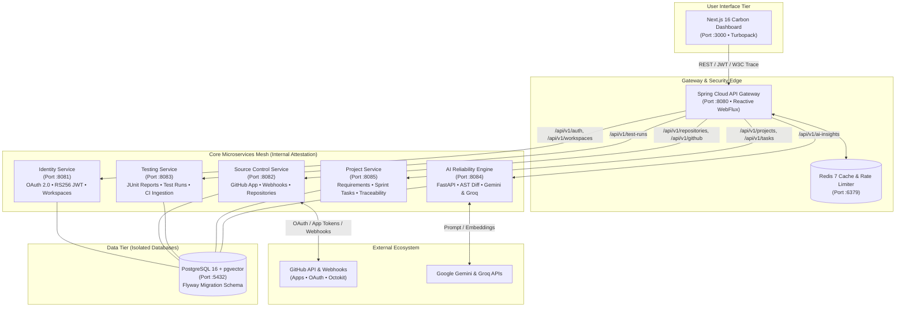
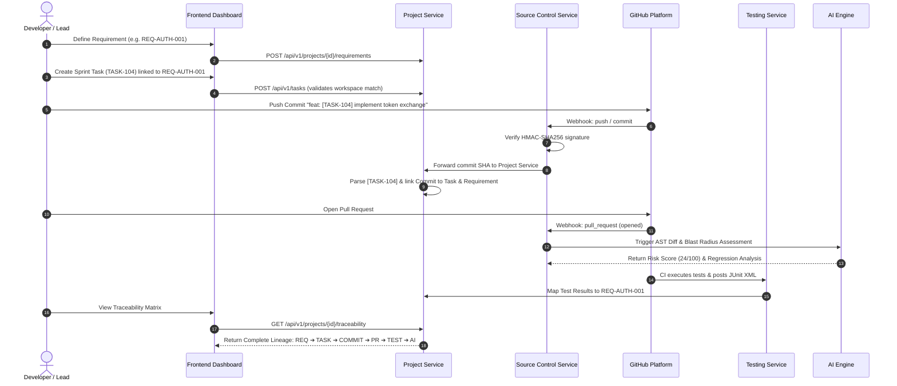

<div align="center">

# ⚡ ForgeAI

### Autonomous Enterprise Engineering Governance Matrix & AI Operating System

*Bridging sprint requirements, source control, automated test execution, and generative AI blast-radius intelligence into a unified, cryptographically verified traceability spine.*

<br/>

[](https://www.docker.com/)
[](https://openjdk.org/)
[](https://spring.io/projects/spring-boot)
[](https://nextjs.org/)
[](https://www.python.org/)
[](https://www.postgresql.org/)
[](https://redis.io/)
[](#-security-architecture--threat-mitigations)

<br/>

[Overview](#-overview--the-problem) •
[Key Innovations](#-core-capabilities--innovations) •
[Architecture](#-distributed-system-architecture) •
[Traceability Spine](#-the-traceability-spine) •
[Microservice Catalog](#-microservice-catalog) •
[Getting Started](#-getting-started) •
[Security Model](#-security-architecture--threat-mitigations) •
[Testing](#-testing--verification-suite)

---

</div>

## 📌 Overview & The Problem

In modern enterprise software engineering, software delivery is fragmented across isolated silos:
* **Product Requirements** reside in project management tools (Jira, Linear).
* **Code Modifications** occur in distributed version control (GitHub, GitLab).
* **Test Verification** executes in disparate CI/CD runners (GitHub Actions, Jenkins).
* **Architectural Risk** is assessed ad-hoc during post-mortems or code reviews.

When an outage occurs or compliance auditors demand verification, engineering teams spend days manually correlating Git commits and pull requests back to approved requirement specifications.

**ForgeAI solves this by introducing an autonomous, real-time Engineering Governance Matrix.** It binds every product requirement to sprint tasks, Git commits, GitHub Pull Requests, automated JUnit test suites, and LLM-driven architectural blast-radius risk evaluations in an immutable, deterministic **Traceability Spine**.

```
[ REQUIREMENT ] ➔ [ SPRINT TASK ] ➔ [ GIT COMMIT ] ➔ [ PULL REQUEST ] ➔ [ CI TEST RUN ] ➔ [ AI BLAST RADIUS ]
```

---

## ✨ Core Capabilities & Innovations

### 🧬 1. The Traceability Spine
* **Deterministic Bidirectional Lineage:** Every code modification is tied to an explicit requirement UUID and task key. Audit trails can be traversed in both directions (`REQ ➔ Code` or `Commit ➔ Business Requirement`).
* **Automated Git Activity Sync:** Webhook listeners automatically detect task keys in commit messages (e.g. `[FORGE-101] Fix SQL race condition`) and pull request bodies, instantly updating sprint boards without manual developer intervention.
* **Traceability Matrices & Snapshots:** Export point-in-time cryptographic snapshots of requirement-to-test coverage for regulatory compliance (SOC 2, ISO 27001).

### 🤖 2. AI Code Intelligence & Blast Radius Engine
* **Semantic AST Diffing:** Parses unified diffs across commits and pull requests into Abstract Syntax Tree (AST) representations to detect altered function signatures, database schema shifts, and breaking API changes.
* **Multi-LLM Hybrid Orchestration:** Leverages **Google Gemini 1.5 Flash** for rapid contextual embeddings and **Groq (Llama 3.3 70B Versatile)** for deep architectural impact reasoning.
* **Regression Risk Index (0–100):** Real-time heuristic scoring combining code churn, file criticality, test coverage gaps, and author historical blast-radius metrics.
* **Automated Remediation Advisories:** Generates targeted test plan recommendations and security patch guidance for high-risk pull requests before they merge.

### ⚡ 3. Enterprise GitHub App & Reactive Webhook Mesh
* **Frictionless One-Click Onboarding:** Unified onboarding combining GitHub OAuth identity linking with GitHub App installation into a single automated step.
* **Live Repository Discovery:** Discovers all public and private repositories accessible to the authenticated account without requiring manual entry of installation or repository numeric IDs.
* **Automated Sync & Reconcile:** Connects repositories with automatic ingestion of recent commits, pull requests, and CI workflow runs, ensuring zero onboarding delay.
* **Cryptographic Single-Use State Security:** Installation flows use cryptographically random 256-bit tokens with a 15-minute TTL, consumed atomically to eliminate state injection and replay attacks.

### 🛡️ 4. Strict Workspace & Multi-Tenant Isolation
* **Personal Workspaces (`organization_id = NULL`):** Individual developers can connect private GitHub accounts and personal repositories without requiring an enterprise organization structure.
* **Enterprise Organizations (`organization_id = UUID`):** Teams enjoy role-based multi-tenancy with strict RBAC boundary checks.
* **Zero Cross-Workspace Leakage:** Strict database check constraints (`chk_repo_scope`, `chk_gh_install_scope`) and fail-closed tenant filters ensure User A cannot enumerate, query, or observe User B's repositories, tasks, or credentials.

### 🎨 5. Linear / Carbon Modern Aesthetic
* **Vercel / Linear Carbon UI:** Engineered with Next.js 16 (App Router + Turbopack), Tailwind CSS, Lucide icons, and Framer Motion.
* **Visual Information Density:** Monospace short commit SHA pills (`71ebe13`), dynamic sync status badges (Synchronized, Syncing, Stale, Inaccessible), interactive Kanban boards, and glassmorphic telemetry cards.

---

## 📐 Distributed System Architecture

ForgeAI operates as a reactive, event-driven microservices architecture communicating via REST APIs, asynchronous outbox messaging, and Redis rate-limiting:



---

## 🧬 The Traceability Spine

The following sequence illustrates how ForgeAI deterministically tracks an engineering artifact through its entire lifecycle:



---

## 📦 Microservice Catalog

| Service | Port | Runtime / Framework | Database / Cache | Responsibilities |
| :--- | :--- | :--- | :--- | :--- |
| **API Gateway** | `8080` | Java 21, Spring Cloud Gateway | Redis 7 | JWT authentication, W3C trace propagation, Redis sliding-window rate limiting, fail-closed internal header attestation. |
| **Frontend UI** | `3000` | Node 20, Next.js 16 (Turbopack) | Browser Cache | Modern Carbon/Linear dashboard, one-click GitHub connect, Kanban task board, traceability matrix, AI analytics. |
| **Identity Service** | `8081` | Java 21, Spring Boot 3.2 | PostgreSQL (`forgeai_identity`) | Asymmetric RS256 JWT issuance, GitHub OAuth 2.0 handshake, personal and enterprise workspace lifecycle. |
| **Source Control** | `8082` | Java 21, Spring Boot 3.2 | PostgreSQL (`source_control_db`) | GitHub App installation orchestration, HMAC webhook verification, repo discovery, commit and PR synchronization. |
| **Testing Service** | `8083` | Java 21, Spring Boot 3.2 | PostgreSQL (`testing_db`) | Ingestion of JUnit XML reports, automated test run cataloging, test case failure tracking, requirement linking. |
| **Project Service** | `8085` | Java 21, Spring Boot 3.2 | PostgreSQL (`project_db`) | Governed projects, sprint tasks, engineering requirements backlog, traceability spine aggregation. |
| **AI Reliability** | `8084` | Python 3.11, FastAPI | PostgreSQL + pgvector (`ai_db`) | AST code diff parsing, semantic code embeddings, blast radius scoring, Gemini 1.5 & Groq Llama 3.3 orchestration. |
| **PostgreSQL** | `5432` | PostgreSQL 16 + pgvector | Persistent Volume | Multi-database relational storage, Flyway managed schema migrations, vector similarity indexes. |
| **Redis** | `6379` | Redis 7 Alpine | In-Memory | Gateway distributed rate limiting, token revocation lists, ephemeral cache. |

---

## 🔒 Security Architecture & Threat Mitigations

ForgeAI was engineered with defense-in-depth security principles:

| Threat / Vulnerability | Vector | ForgeAI Mitigation |
| :--- | :--- | :--- |
| **State Injection / Replay** | Attacker intercepts or replays GitHub installation redirect | **Cryptographic Single-Use State Tokens:** 256-bit secure random state token stored in database with a 15-minute TTL. Consumed atomically on callback; second submission is rejected. |
| **Cross-Tenant Identifier Snooping** | User B queries User A's repository UUID | **Workspace & Owner Isolation:** Repository lookups strictly enforce `callerUserId == claimedByUserId` and `workspaceId == repo.workspaceId`. Foreign access attempts return `404 Not Found` to prevent resource enumeration. |
| **Internal Header Spoofing** | Untrusted client sends spoofed `X-Workspace-Id` or `X-User-Id` | **Fail-Closed Internal Attestation:** Microservices reject all incoming requests containing tenant context headers unless accompanied by `X-ForgeAI-Internal: attested` signed by the API Gateway. Default: `@Value("${forgeai.security.enforce-internal-marker:true}")`. |
| **Forged Webhooks** | Attacker submits malicious push payloads | **Cryptographic HMAC-SHA256:** Source Control Service validates the `X-Hub-Signature-256` header against the configured webhook secret before parsing any payload. |
| **Database Boundary Violation** | Application logic omits workspace filters | **SQL Check Constraints:** `source_control_db` enforces `chk_repo_scope` (`scope = 'PERSONAL' AND organization_id IS NULL OR scope = 'ORGANIZATION' AND workspace_id = organization_id`). |

---

## 🚀 Getting Started

### Prerequisites

* **Docker Desktop** (with Docker Compose v2)
* **Node.js 20+** and **npm**
* **Java 21 JDK** & **Maven 3.9+** (for host development and compilation)
* **Python 3.11+** (for AI Service)

### 1. Clone Repository & Setup Secrets

```bash
git clone https://github.com/rajpagare01/ForgeAI.git
cd ForgeAI
```

Create your `.env` file based on `.env.example`:

```bash
cp .env.example .env
```

Configure the environment variables in `.env`:

```env
# -----------------------------------------------------------------------------
# GitHub App & OAuth Integration
# -----------------------------------------------------------------------------
GITHUB_APP_ID=123456
GITHUB_APP_SLUG=your-github-app-slug
GITHUB_CLIENT_ID=your-github-oauth-client-id
GITHUB_CLIENT_SECRET=your-github-oauth-client-secret
GITHUB_WEBHOOK_SECRET=your-secure-webhook-secret
GITHUB_APP_PRIVATE_KEY_PATH=/app/secrets/github-app-private-key.pem

# -----------------------------------------------------------------------------
# AI Services & LLM API Keys
# -----------------------------------------------------------------------------
GEMINI_API_KEY=your_google_gemini_api_key
GEMINI_MODEL=gemini-1.5-flash
GROQ_API_KEY=your_groq_api_key
GROQ_MODEL=llama-3.3-70b-versatile

# -----------------------------------------------------------------------------
# Database & Security
# -----------------------------------------------------------------------------
POSTGRES_USER=forgeai
POSTGRES_PASSWORD=forgeai_secure_password
JWT_SECRET=your-secure-256-bit-jwt-secret-string
```

Place your GitHub App's private key (`.pem`) in the `secrets/` directory:
```bash
mkdir -p secrets
cp /path/to/your-app.private-key.pem secrets/github-app-private-key.pem
```

### 2. Boot the Entire Platform

Launch all 9 microservices, databases, and caches in detached mode:

```bash
docker compose -f docker-compose.dev.yml up -d
```

Verify that all containers are healthy:

```bash
docker ps --format "table {{.Names}}\t{{.Status}}\t{{.Ports}}"
```

Expected healthy output:
```
NAMES                                         STATUS                    PORTS
forgeai-frontend-dev                          Up (healthy)              0.0.0.0:3000->3000/tcp
forgeai-api-gateway-dev                       Up (healthy)              0.0.0.0:8080->8080/tcp
forgeai-ai-dev                                Up (healthy)              0.0.0.0:8084->8084/tcp
1bfb1a09d875_forgeai-source-control-dev       Up (healthy)              0.0.0.0:8082->8082/tcp
0cb25774b0c0_forgeai-testing-dev              Up (healthy)              0.0.0.0:8083->8083/tcp
917c21ad61bb_forgeai-project-dev              Up (healthy)              0.0.0.0:8085->8085/tcp
95a99c4e8e32_forgeai-identity-dev             Up (healthy)              0.0.0.0:8081->8081/tcp
forgeai-postgres-dev                          Up (healthy)              0.0.0.0:5432->5432/tcp
forgeai-redis-dev                             Up (healthy)              0.0.0.0:6379->6379/tcp
```

### 3. Access ForgeAI

* **Web Application:** [http://localhost:3000](http://localhost:3000)
* **API Gateway Base:** [http://localhost:8080](http://localhost:8080)
* **Healthcheck Actuators:**
  * Gateway Health: `http://localhost:8080/actuator/health`
  * Identity Service: `http://localhost:8081/actuator/health`
  * Source Control: `http://localhost:8082/actuator/health`
  * Project Service: `http://localhost:8085/actuator/health`
  * Testing Service: `http://localhost:8083/actuator/health`
  * AI Service Health: `http://localhost:8084/healthz`

---

## 🧪 Testing & Verification Suite

ForgeAI maintains comprehensive automated test coverage across all microservice layers.

### Run All Unit & Integration Tests

```bash
# 1. Source Control Service (Security & GitHub Installation Tests)
mvn test -pl services/source-control-service

# 2. Project Service (Traceability & Requirement Boundary Tests)
mvn test -pl services/project-service

# 3. Identity Service (Authentication & Multi-Tenant Tests)
mvn test -pl services/identity-service

# 4. API Gateway (Routing & Rate Limiting Tests)
mvn test -pl infrastructure/api-gateway

# 5. AI Service (AST & Regression Prediction Tests)
pytest services/ai-service/tests

# 6. Frontend Typecheck & Production Build
cd frontend
npx tsc --noEmit
npx next build --webpack
```

---

## 🗺️ Project Structure

```text
ForgeAI/
├── frontend/                               # Next.js 16 Web Dashboard
│   ├── src/app/(dashboard)/                # Route groups (projects, repositories, ai-insights)
│   ├── src/components/                     # Carbon design system UI components
│   └── src/lib/                            # API client, tenant context, and state utilities
├── services/
│   ├── identity-service/                   # Auth, JWT, OAuth 2.0 & Workspaces
│   ├── source-control-service/             # GitHub App, Webhook Ingestion & Commits
│   ├── project-service/                    # Requirements, Tasks & Traceability Spine
│   ├── testing-service/                    # JUnit Ingestion & Test Verification
│   └── ai-service/                         # Python FastAPI, AST Diffing & Blast Radius
├── infrastructure/
│   ├── api-gateway/                        # Spring Cloud Gateway (Edge Router)
│   └── postgres/                           # Multi-database initial SQL schemas
├── docker-compose.dev.yml                  # Local development container orchestration
├── docker-compose.prod.yml                 # Production-hardened container stack
└── pom.xml                                 # Root Maven Reactor build definition
```

---

## 👥 Authors & Acknowledgements

* **Raj Pagare** ([@rajpagare01](https://github.com/rajpagare01)) — *Lead Architect & Full-Stack Systems Engineer*
* **ForgeAI Core Engineering Team** — *Major Project 2026*

---

## 📄 License

This project is licensed under the **Apache License 2.0** — see the [LICENSE](LICENSE) file for details.
