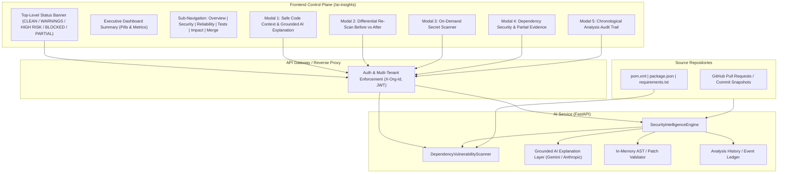

# Architecture: Unified Engineering Health, Bug, Security & Secret Detection

## 1. System Overview

ForgeAI provides an integrated, authoritative **Engineering Health and Security Workflow** designed for modern engineering organizations. It unifies static security analysis, pattern-based secret detection, dependency vulnerability tracking, reliability checks, and code review recommendations into a single authoritative control plane.



---

## 2. Core Architectural Principles

### 2.1 Deterministic Evidence vs. AI Reasoning
- **Deterministic Single Source of Truth**:
  - Finding identification, severity classification, line counts, blast radius scores, and test impact rankings are strictly computed by deterministic rules, AST analyzers, and pattern matchers (`SecurityIntelligenceEngine`, `DependencyVulnerabilityScanner`).
  - LLMs **NEVER** originate or fabricate security vulnerabilities, CVEs, or bug counts.
- **Role of the AI Explanation Layer**:
  - The AI model is strictly a **grounded reasoning layer**.
  - When an engineer requests an explanation (`/api/v1/ai/explain-finding`), the deterministic finding metadata is supplied as immutable factual ground truth. The model contextualizes the finding, outlines exploitation mechanics, and suggests compliant remediations without hallucinating additional findings.

### 2.2 Zero Raw Secret Exposure
- Under no circumstance are unredacted secret tokens (AWS keys, GitHub tokens, Stripe secrets, private keys, JWTs) ever:
  - Logged in standard stdout/stderr
  - Stored in databases or analysis histories
  - Returned in HTTP responses
  - Rendered in DOM trees or client modals
- Tokens are masked with `***[REDACTED_LEN_X]` or `[REDACTED SECRET]` at the earliest point of capture.
- Context extraction displays safe code windows ($[-3, +3]$ lines) with strictly sanitized tokens.

### 2.3 Truthful Evidence Contract
- External CVE databases require live commercial feeds. When an external CVE database is unconfigured, ForgeAI reports **`PARTIAL EVIDENCE`**.
- Manifest parsing for **Maven** (`pom.xml`), **npm** (`package.json`), and **Python** (`requirements.txt`, `pyproject.toml`) is active and verified, but the platform explicitly discloses that dependency CVE matching is unconfigured rather than fabricating synthetic CVEs.

### 2.4 Authoritative Differential Re-Scan
- Re-scans (`POST /api/v1/ai/analyses/{id}/re-scan`) re-execute deterministic analysis on candidate code changes.
- Findings are marked **RESOLVED** only when deterministic rules verify their absence in the new code changeset.
- Remediation effectiveness is never granted based on LLM claims alone.

### 2.5 Multi-Tenant Isolation
- All scan requests, analysis histories, and on-demand tools enforce workspace-level scoping via `X-Org-Id` or personal tenant bounds.
- Analyses cannot be accessed across tenant boundaries.

---

## 3. Component Architecture & Endpoints

| Component | Endpoint | Description |
| :--- | :--- | :--- |
| **Repository Snapshot Scan** | `POST /api/v1/ai/repositories/{id}/security-scan` | Runs full static analysis & secret scan across snapshot files. |
| **On-Demand Secret Scan** | `POST /api/v1/ai/repositories/{id}/secret-scan` | Lightweight, high-speed credential inspection. |
| **Dependency Security** | `GET /api/v1/ai/repositories/{id}/dependency-security` | Reports manifest parsing status and CVE feed availability. |
| **Differential Re-Scan** | `POST /api/v1/ai/analyses/{id}/re-scan` | Calculates Before vs After risk deltas and verified resolved findings. |
| **Grounded Explanation** | `POST /api/v1/ai/explain-finding` | Supplies grounded technical explanations and remediation steps. |
| **Analysis History** | `GET /api/v1/ai/analyses/{entity_type}/{entity_id}/history` | Chronological audit trail of differential analysis runs. |

---

## 4. Frontend Status Lifecycle

The frontend status banner evaluates the repository/PR state into one of five authoritative states:

```
+--------------------------------------------------------------------------+
|  Status              | Criteria                                          |
+--------------------------------------------------------------------------+
|  CRITICAL / BLOCKED  | critical_count > 0 OR status == SECURITY_BLOCKER  |
|  HIGH RISK           | high_count > 0                                    |
|  PARTIAL EVIDENCE    | evidence_status == PARTIAL OR dep_status == PARTIAL|
|  WARNINGS            | medium_count > 0 OR low_count > 0                 |
|  CLEAN               | Zero findings detected & verified clean           |
+--------------------------------------------------------------------------+
```

---

## 5. Live End-to-End Engineering Intelligence Lifecycle

ForgeAI connects the entire engineering lifecycle into an integrated, deterministic AI Engineering Operating System:

```mermaid
flowchart LR
    P[Project] --> R[Requirement]
    R --> T[Task]
    T --> Repo[Repository]
    Repo --> B[Branch]
    B --> C[Commit]
    C --> PR[Pull Request]
    PR --> CI[CI / Tests Ingestion]
    CI --> AI[AI Engineering Health]
    AI --> Findings[Security & Bug Detection]
    Findings --> Risk[Unified Risk & Merge Gate]
    Risk --> Rem[Controlled Remediation]
    Rem --> Rescan[Differential Re-Scan]
    Rescan --> Merge[Merge Ready]
```



### 5.1 Lifecycle Steps & Invariants

1. **Project & Requirement**: Created in `project-service` with business context and acceptance criteria.
2. **Task & Traceability Linkage**: Linked to requirements and developer assignments (`taskTraceabilityRepository`).
3. **Repository, Branch & Commit**: Source control events ingested via GitHub App webhooks (`source-control-service`).
4. **Pull Request Changeset**: Change diffs parsed via tree-sitter AST extractors into modified symbols, functions, and classes.
5. **CI / Test Execution**: Test runs ingested (`testing-service`), strictly maintaining deterministic ground truth (`failed_required_tests`) separate from AI recommendations (`must_run` / `should_run`).
6. **Security Intelligence**: Secrets detected with zero unmasked leaks (`***[REDACTED_LEN_X]`), plus code-level injection and configuration analysis.
7. **Reliability Intelligence**: AST bug patterns identified with calibrated confidence terminology (`DETECTED`, `LIKELY`, `SUSPICIOUS`, `REQUIRES REVIEW`).
8. **Unified Risk & Merge Gate**: Deterministic aggregation of local risk, distributed risk, security posture, and test coverage into a unified score and blocking decision (`BLOCKED` vs `READY`).
9. **Controlled Remediation**: Advisory and controlled branch patch generation with AST validation and zero arbitrary shell execution.
10. **Differential Re-Scan**: Deterministic re-verification confirming findings are fixed before reducing risk score or clearing merge blockers.
11. **Multi-Tenant Isolation**: Enforced across every controller and engine via tenant scoping (`organization_id`).

