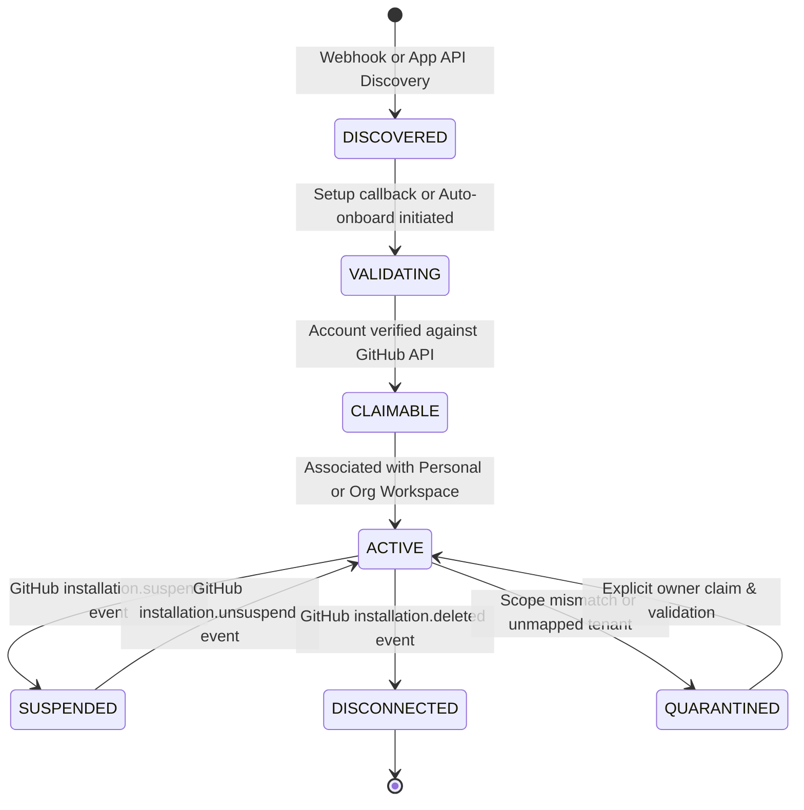

# ForgeAI Architecture — Automatic GitHub App Installation Discovery & Workspace Onboarding

## 1. Overview

ForgeAI provides an automated, secure, and developer-friendly onboarding lifecycle for GitHub App integrations.

A developer must **never** manually locate, copy, or input a numeric GitHub `installation_id`. ForgeAI automatically discovers, validates, associates, and synchronizes GitHub App installations across both **Personal Workspaces** and **Organization Workspaces**, while preserving strict multi-tenant isolation, cryptographic authenticity, and repository engineering intelligence.

```text
┌────────────────────────┐      ┌───────────────────────────┐      ┌─────────────────────────┐
│ Continue with GitHub   │ ───► │ ForgeAI User              │ ───► │ Personal or Org         │
│ (User OAuth Identity)  │      │ (JWT / Session Principal) │      │ Workspace Context       │
└────────────────────────┘      └───────────────────────────┘      └─────────────────────────┘
                                                                                 │
                                                                                 ▼
┌────────────────────────┐      ┌───────────────────────────┐      ┌─────────────────────────┐
│ Synchronized Repo &    │ ◄─── │ Repositories Discovered   │ ◄─── │ Install / Connect       │
│ Traceable AI Health    │      │ (Multi-Select Import)     │      │ ForgeAI GitHub App      │
└────────────────────────┘      └───────────────────────────┘      └─────────────────────────┘
                                                                                 │
                                                                                 ▼
                                                                   ┌─────────────────────────┐
                                                                   │ Installation Discovered │
                                                                   │ & Verified with GitHub  │
                                                                   └─────────────────────────┘
```

---

## 2. Core Architectural Distinctions

To prevent security vulnerabilities and tenant confusion, ForgeAI maintains clean separation across five fundamental entities:

| Layer | Responsibility | Persistence / Identifier | Auth Mechanism |
| :--- | :--- | :--- | :--- |
| **GitHub User Identity** | Developer's personal GitHub account profile. | `user_github_identities` (`github_user_id`, `github_login`) | GitHub OAuth User Token (`read:user, user:email`) |
| **ForgeAI User & Workspace** | Identity and multi-tenant resource boundaries. | `users` (`id` UUID), `workspaces` (`id` UUID) | Asymmetric RS256 ForgeAI JWT (`X-User-Id`, `X-Workspace-Id`) |
| **ForgeAI GitHub App** | Registered GitHub App with fine-grained permissions. | Server configuration (`appId`, RSA private key) | App JWT signed via RS256 (expires in 10 minutes) |
| **GitHub App Installation** | Authorization granted to the App on an Account. | `github_installations` (`installation_id` BIGINT) | Dynamic Installation Access Token (expires in 1 hour) |
| **Source Repositories** | Synchronized codebases attached to workspaces. | `repositories` (`id` UUID, `github_repo_id` BIGINT) | Scoped via Workspace & Installation access token |

---

## 3. Installation Discovery Architecture

ForgeAI supports three automated discovery channels:

### Source A — Signed GitHub Webhooks
When an administrator installs or modifies the GitHub App, GitHub delivers signed webhook events:
1. `installation.created`: Extracts `installation.id`, `app_id`, `account.id`, `account.login`, and `repository_selection`.
2. HMAC SHA-256 signature is verified prior to JSON parsing using `GITHUB_WEBHOOK_SECRET`.
3. If an organization or user workspace mapping is matched, the installation is registered or updated directly. If unmapped, it is placed in `DISCOVERED` or quarantine state awaiting workspace association.

### Source B — GitHub App Setup Redirect URL
When installation completes, GitHub redirects the user back to ForgeAI:
`https://app.forgeai.dev/repositories?installation_id=12345678`
- The query parameter `installation_id` is treated strictly as an untrusted client hint.
- ForgeAI executes real-time server-side verification before any database association occurs.

### Source C — GitHub API Installation Discovery
When an authenticated user loads the Repositories page, ForgeAI queries GitHub App APIs via App JWT:
- `GET /users/{username}/installation`: Discovers the user's personal GitHub App installation.
- `GET /orgs/{org}/installation`: Discovers the organization's GitHub App installation.
- `GET /app/installations`: Inspects app-level installations matching candidate accounts.

---

## 4. Anti-Spoofing Protocol for Setup Redirect URLs

GitHub documentation warns that query parameters on setup redirect URLs can be manipulated by malicious actors attempting to claim victim installations. ForgeAI neutralizes this threat through a strict verification protocol:

```text
Client Browser Redirect (?installation_id=12345678)
          │
          ▼
POST /api/v1/installations/setup-callback
          │
          ├── 1. Check ForgeAI JWT session (Caller User ID & Workspace)
          ├── 2. Query GitHub API with signed App JWT: GET /app/installations/12345678
          │      └── Retrieves authoritative account.id, account.login, and account.type
          ├── 3. Resolve caller's linked GitHub account via Identity Service:
          │      └── Fetch user_github_identities (github_user_id)
          └── 4. Ownership Verification:
                 ├── Personal Workspace: Does installation account.id == caller github_user_id?
                 │   ├── NO  ──► 403 Forbidden: GitHubAccessDeniedException
                 │   └── YES ──► Associate installation with Personal Workspace
                 └── Org Workspace: Is caller an authorized Admin of this ForgeAI Organization?
                     ├── NO  ──► 403 Forbidden
                     └── YES ──► Associate installation with Organization Workspace
```

---

## 5. Multi-Tenant Workspace Association Rules

1. **Personal Workspace Invariants**:
   - `workspace.type == PERSONAL`
   - `workspace.owner_user_id == callerUserId`
   - `scope == 'PERSONAL'`
   - `organization_id IS NULL`
   - Only the matching GitHub account owner can claim or bind a personal installation.
   - User A can never claim or view User B's personal installation or repositories.

2. **Organization Workspace Invariants**:
   - `workspace.type == ORGANIZATION`
   - `scope == 'ORGANIZATION'`
   - `organization_id == workspace_id`
   - Caller must be an authorized member/admin of the organization.
   - Multi-tenant cross-org claims are prevented via unique constraint and ownership checks.

3. **Database Scope Integrity (`chk_gh_install_scope`)**:
   ```sql
   ALTER TABLE github_installations ADD CONSTRAINT chk_gh_install_scope CHECK (
       (status IN ('DISCOVERED', 'VALIDATING', 'CLAIMABLE', 'QUARANTINED') AND workspace_id IS NULL) OR
       (scope = 'ORGANIZATION' AND organization_id IS NOT NULL AND workspace_id IS NOT NULL AND workspace_id = organization_id) OR
       (scope = 'PERSONAL' AND workspace_id IS NOT NULL AND organization_id IS NULL)
   );
   ```

---

## 6. Installation State Machine



---

## 7. Dynamic Installation Token Management

ForgeAI implements `GitHubInstallationTokenService` following strict security invariants:
1. **Dynamic Generation**: Tokens are generated on-demand by exchanging an RS256 App JWT at `POST /app/installations/{id}/access_tokens`.
2. **Short-Lived Caching**: Tokens are cached in-memory with a safety margin (55 minutes, prior to GitHub's 60-minute expiry).
3. **No Database Persistence**: Access tokens are never written to database tables or permanent configuration.
4. **No Egress**: Tokens are never exposed to the frontend, browser cookies, error traces, or AI prompts.
5. **Auto-Eviction**: On HTTP 401 or 403 from GitHub API, cached tokens are evicted immediately.

---

## 8. Webhook Ingestion & Lifecycle Events

All inbound webhooks at `/api/v1/webhooks/github` undergo HMAC SHA-256 verification:

- `installation.created`: Discovers installation metadata and updates active status.
- `installation.deleted`: Sets installation to `DELETED` and transitions all attached repositories to `DISCONNECTED`. Engineering history (commits, pull requests, AI health metrics) is preserved.
- `installation.suspend`: Suspends background synchronization.
- `installation.unsuspend`: Reactivates synchronization.
- `installation_repositories.added`: Synchronizes newly attached repositories.
- `installation_repositories.removed`: Marks removed repositories as `INACCESSIBLE` without deleting traceability chains.

---

## 9. Repository Discovery & Import (ALL vs SELECTED Modes)

1. The frontend invokes `GET /api/v1/repositories/available?workspaceId={id}`.
2. The backend fetches accessible repositories live from GitHub via `GET /installation/repositories`.
3. The UI presents an interactive multi-select interface with checkboxes:
   - Status indicators (`Ready to import`, `Connected`).
   - Default branch and visibility (Public / Private).
   - "Select All" toggle and count tracker.
4. The user clicks `[Import Selected]`, which calls `POST /api/v1/repositories/batch-connect`.
5. The backend validates accessibility for each selected repository, creates or updates repository records, and emits `RepositoryConnectedEvent` into the transactional outbox.

---

## 10. Idempotent Reconciliation Protocol

Admins and developers can re-synchronize installation access at any time via:
`POST /api/v1/installations/{id}/reconcile?workspaceId={id}`

Reconciliation steps:
1. Validates installation ownership and active workspace authorization.
2. Queries GitHub API for the latest installation status and repository selection.
3. Fetches live list of accessible repositories.
4. Computes diff against existing ForgeAI database records:
   - **Newly added**: Creates repository record and triggers branch/commit indexing.
   - **Maintained**: Updates metadata and restores status to `SYNCED`.
   - **Removed on GitHub**: Marks status as `INACCESSIBLE` (halts sync without data loss).
5. Returns a structured `ReconciliationReport` with exact counts.
6. Repeated executions produce stable, idempotent results.

---

## 11. Audit Logging & Telemetry

- All discovery, claim, setup callback, and reconciliation operations generate audit logs.
- `InstallationTelemetryReconciler` continuously updates tenant and system metrics (`totalInstallations`, `activeInstallations`, `quarantinedInstallations`).
- All external GitHub API latency, status codes, and rate limits are metered and monitored.

---

## 12. Developer Experience (Zero Manual ID)

The onboarding experience is intuitive and automated:
1. Developer logs in with GitHub OAuth.
2. Navigates to **Repositories**.
3. If no installation exists:
   - Direct button: `[Install ForgeAI GitHub App]` redirects to GitHub App installation page.
4. Upon completing installation on GitHub:
   - GitHub redirects back to ForgeAI (`?installation_id=...`).
   - ForgeAI validates ownership automatically, displays a success notification, cleans the URL, and presents accessible repositories for import.
5. If user navigates back manually:
   - ForgeAI's discovery service automatically detects the candidate installation on GitHub and displays `[Connect Discovered Installation]`.
6. User selects desired repositories and clicks `[Import Selected]`.
7. Traceability, PR reviews, and AI Engineering Health immediately begin synchronizing.

---

## 13. Security Threat Model & Mitigations

| Threat Vector | Potential Impact | ForgeAI Mitigation |
| :--- | :--- | :--- |
| **Setup URL Query Spoofing** | Attacker claims someone else's installation by passing arbitrary `installation_id`. | Backend queries GitHub API with App JWT and verifies `installation.account.id == user.github_user_id`. Mismatches return HTTP 403. |
| **Cross-Tenant Repository Snooping** | User A tries to view or connect User B's personal repositories. | Strict workspace validation in `validateWorkspaceAccess` verifies `callerUserId == workspace.owner_user_id`. |
| **Fake Webhook Payloads** | Attacker sends crafted push/installation webhooks. | HMAC SHA-256 signature verification rejects any unauthenticated payloads with HTTP 401. |
| **Token Exposure** | Leaked installation access tokens grant unauthorized repository access. | Tokens are stored exclusively in volatile memory cache, never logged, and never exposed over APIs. |
| **Data Loss on Revocation** | User revokes repository access on GitHub. | Repository is marked `INACCESSIBLE` instead of deleted; all requirements, tasks, PRs, and AI audits remain fully traceable. |
